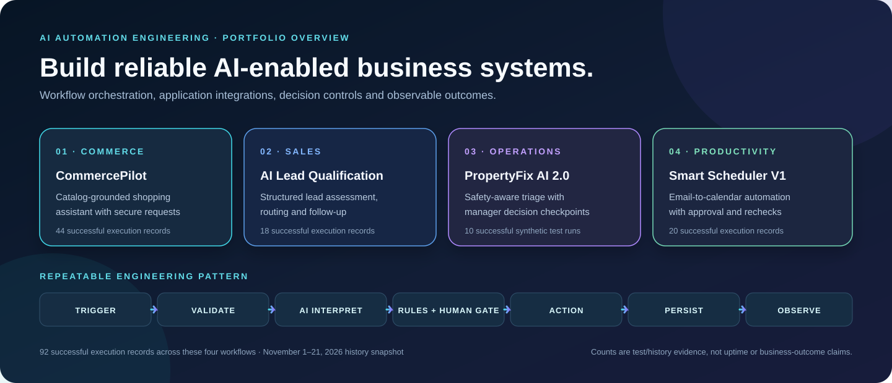

# AI Automation Portfolio

### AI Automation Engineer | n8n Workflow Engineering | LLM Agents | API Integrations | JavaScript · TypeScript · Python

I design and build AI-powered business systems that connect language models, workflow orchestration, APIs, operational tools, and persistent data. My focus is not simply connecting nodes: I build the validation, deterministic rules, human approval, audit trails, and monitoring that make automations useful and safer to operate.

**Open the portfolio:** [Flagship case studies](PROJECTS.md) · [Visual proofs](VISUAL_PROOFS.md) · [36-workflow n8n audit](N8N_WORKFLOW_AUDIT.md) · [Project folders](projects/README.md) · [AwtomateAI](https://awtomateai.com)

> **2-minute technical review for hiring managers:**
> Start with [CommercePilot](projects/commercepilot) (Shopify App Proxy HMAC + Redis + n8n + Groq + Supabase), [Smart Scheduler V1](projects/smart-scheduler) (approval gate + conflict recheck + ledger idempotency), and [PropertyFix AI 2.0](projects/propertyfix-ai) (deterministic safety overrides over LLM triage). Repository integrity and Python adapter unit tests are verified on every push via [Portfolio CI](.github/workflows/portfolio-ci.yml).

---

## Portfolio at a glance

| Evidence snapshot | Verified position |
|---|---|
| Featured systems | 4 documented end-to-end systems |
| Execution history | **92 successful records** across the four featured n8n workflows, November 1–21, 2026 |
| Workflow inventory | 36 workflows audited on November 20, 2026 |
| Inventory state | 12 active · 24 inactive at the November 20 audit |
| Engineering focus | AI orchestration, workflow design, API integration, business rules, persistence, and reliability |

Execution records are dated n8n history snapshots—not uptime guarantees, paid-client outcomes, revenue, conversion lift, or time-saved metrics. See the [visual evidence and limitations](VISUAL_PROOFS.md).

## Featured systems

### 1. [CommercePilot — Shopify AI Shopping Assistant](projects/commercepilot)

**Commerce · Platform engineering · AI product discovery**

A Shopify-native shopping assistant that grounds product answers in a connected store's catalog, uses store-scoped conversation context, and checks live variant availability for stock questions. The wider system includes Shopify App Proxy HMAC validation, Redis replay/rate controls, n8n orchestration, catalog synchronization, conversation persistence, and health monitoring.

- **44 successful assistant execution records** in the November 1–21 history snapshot.
- Current n8n draft: **42 nodes**; published active version: **37 nodes**. The graphs differ.
- Catalog sync: **26 successes / 27 records**, development store only.
- Shopify app Preview deployment was marked READY in the November 20 project snapshot.

**Stage:** Preview and development-store validation. Not a paid-merchant production deployment. Draft-only changes are not presented as published functionality.

[Technical case study](projects/commercepilot) · [Architecture visual](projects/commercepilot/assets/workflow-overview.svg)

### 2. [AI Lead Qualification & Automation Platform](projects/lead-management/n8n)

**Sales operations · Lead qualification · Business automation**

An active website-connected workflow for AwtomateAI. It receives inquiries through a webhook, normalizes lead data, uses an OpenRouter-connected AI agent for qualification, parses the result, records the lead in Google Sheets, and routes high-value, qualified, and lower-value paths into Gmail follow-up and status updates.

- **18-node active workflow**; active version matches the current draft.
- **18 successful execution records** in the November 1–21 history snapshot.
- Current active workflow is distinct from the older 14-node JSON export in this repository.

**Stage:** Operational on the developer's own business website, not a paid-client implementation. No conversion or revenue lift is claimed.

[Technical case study](projects/lead-management/n8n) · [Architecture visual](projects/lead-management/n8n/assets/workflow-overview.svg)

### 3. [PropertyFix AI 2.0 — Maintenance Intelligence](projects/propertyfix-ai)

**Operations · Decision support · Human-supervised triage**

A 17-node maintenance intake and triage proof of concept. It preserves the original request before AI analysis, applies deterministic safety and confidence rules, separates potential emergencies from standard manager review, and persists the manager's decision.

- **10 successful execution records** in the November 1–21 snapshot, using synthetic test data.
- Regression evidence includes negated hazards remaining routine and real sparks/smoke retaining emergency classification.
- Gmail/Slack notifications and approval responses were pinned or simulated in the documented tests.

**Stage:** Internal proof of concept. It does not dispatch contractors, call emergency services, or make tenant-facing safety promises.

[Technical case study](projects/propertyfix-ai) · [Architecture and test visual](projects/propertyfix-ai/assets/workflow-overview.svg)

### 4. [Smart Scheduler V1 — AI-Assisted Email-to-Calendar](projects/smart-scheduler)

**Productivity · API integrations · Approval-based automation**

An active 30-node workflow that screens Gmail messages, checks a persistent ledger, extracts and validates event details, checks calendar conflicts, requests explicit approval, rechecks the ledger and calendar, then creates and records an approved event.

- **20 successful execution records** in the November 1–21 history snapshot.
- Real Gmail-to-approval-to-Google-Calendar event creation and ledger persistence were verified.
- Rejected approval and a simulated post-approval conflict both stopped before an unintended calendar write.

**Stage:** Runs on the developer's own Gmail and Google Calendar account. Sustained polling, concurrency, and load testing remain unverified.

[Technical case study](projects/smart-scheduler) · [Architecture and test visual](projects/smart-scheduler/assets/workflow-overview.svg)

---

## Visual demonstrations

The portfolio includes current workflow architecture maps, dated execution-history evidence, and documented test scenarios. The diagrams are generated from connected n8n workflow metadata and project documentation; they are **not** screenshots of the n8n editor canvas.

[**Open the visual proof gallery →**](VISUAL_PROOFS.md)

The gallery also distinguishes real historical output screenshots from promotional artwork and clearly labels synthetic or simulated test evidence.

## Additional projects

| Project | What it demonstrates | Current boundary |
|---|---|---|
| [AI Business Automation Auditor](projects/business-automation-auditor) | Business discovery, website research, AI opportunity assessment, scoring, and Sheets reporting | Research prototype; results require human verification |
| [Campaign Research & Drafting Agent](projects/campaign-research-agent) | Crawl4AI research, local Ollama drafting, evidence checks, persistent review queue | Inactive; no outbound messages |
| [Automated Voice Inquiry & Support Dispatcher](projects/voice-inquiry-dispatcher) | Audio intake, Whisper transcription, AI conversation, session memory, Piper synthesis | Fresh end-to-end audio acceptance test required |
| [Anna AI — Intelligent Front Desk](projects/anna-omnichannel-receptionist) | Groq agent, session memory, structured responses, Supabase logging | Inactive portfolio prototype |
| [Intelligent Gmail Manager](projects/intelligent-gmail-manager) | Read-only Gmail search, thread retrieval, classification, fail-closed mutation controls | Inactive; mailbox mutations disabled |
| [Business Opportunity Finder](projects/business-opportunity-finder) | Business discovery, website crawling, AI research assessment, Sheets output | Current workflow inactive; public export is historical |
| [Customer Engagement System](projects/customer-engagement) | Customer monitoring and response-management patterns | Portfolio prototypes |
| [Autonomous Job Sourcing](projects/autonomous-job-sourcing) | Job discovery, fit scoring, application drafting, manual review | Prototype; no automatic submissions |

[See the complete project catalog](PROJECTS.md).

## Engineering capabilities

- **Workflow engineering:** n8n, Zapier, webhooks, schedules, subworkflows, branching, batching, retries, and error workflows.
- **AI orchestration:** LLM agents, structured output, prompt design, session memory, model routing, and local inference.
- **Application and API integration:** REST and GraphQL, Shopify Admin API, App Proxy HMAC verification, authenticated webhooks, and third-party services.
- **Business logic:** JavaScript and Python transformations, schema validation, deterministic routing, deduplication, idempotency, and approval gates.
- **Data and persistence:** Supabase/PostgreSQL, n8n Data Tables, Google Sheets, Redis/Upstash, and structured audit records.
- **Reliability:** health checks, latency monitoring, alert routing, safe fallbacks, failure handling, and execution-history review.
- **Development and delivery:** TypeScript, JavaScript, Python, JSON, PowerShell, Vercel Preview deployments, and self-hosted n8n.

## How I engineer automation

1. Understand the real business process, stakeholders, and failure cases.
2. Normalize and validate inputs before AI processing.
3. Use AI for interpretation, extraction, classification, and drafting—not as the only source of truth.
4. Apply deterministic rules for permissions, safety, routing, state changes, and idempotency.
5. Require human approval for consequential actions where appropriate.
6. Persist the original request, useful decisions, and action outcomes.
7. Make failures observable through retries, fallbacks, alerts, and execution history.
8. Document what is verified, simulated, pending, inactive, or intentionally disabled.

## Opportunities

**Employment:** AI Automation Specialist · n8n Automation Developer · Workflow Automation Engineer · AI Integration Developer.

**Freelance and project work:** n8n workflow engineering · AI-powered lead management · Shopify AI shopping experiences · API integrations · operational intake and triage · approval-based business automation.

I present the same engineering work differently for each audience: recruiters can inspect architecture and implementation decisions; clients can see the business process, integration scope, safeguards, and delivery boundaries.

## Evidence, security, and transparency

- Active in n8n does not automatically mean paid-client production deployment.
- Public workflow exports are sanitized and intended for inspection, not one-click production use.
- Credentials, private webhook paths, merchant identifiers, personal inbox/calendar data, and execution payloads are not published.
- Preview deployments and development stores are distinguished from production.
- Synthetic tests and simulated integrations are labeled.
- No paid-client results, ROI, conversion lift, or time-saved claims are made without evidence.

See the [n8n workflow alignment audit](N8N_WORKFLOW_AUDIT.md) for the connected workflow inventory and known export/version differences.

## Contact and links

- **GitHub:** https://github.com/sanau0716
- **Portfolio repository:** https://github.com/sanau0716/ai-automation-portfolio
- **LinkedIn:** https://www.linkedin.com/in/ajbelmonte/
- **AwtomateAI:** https://awtomateai.com
