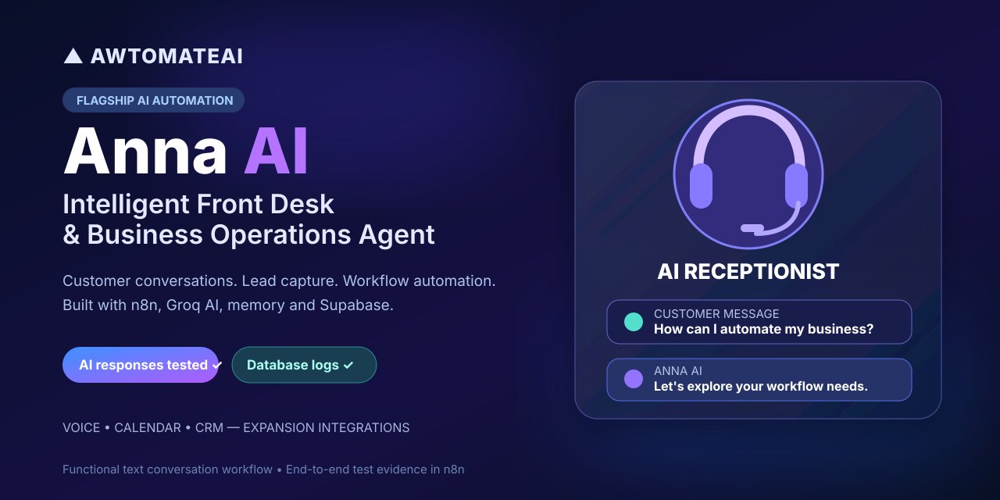
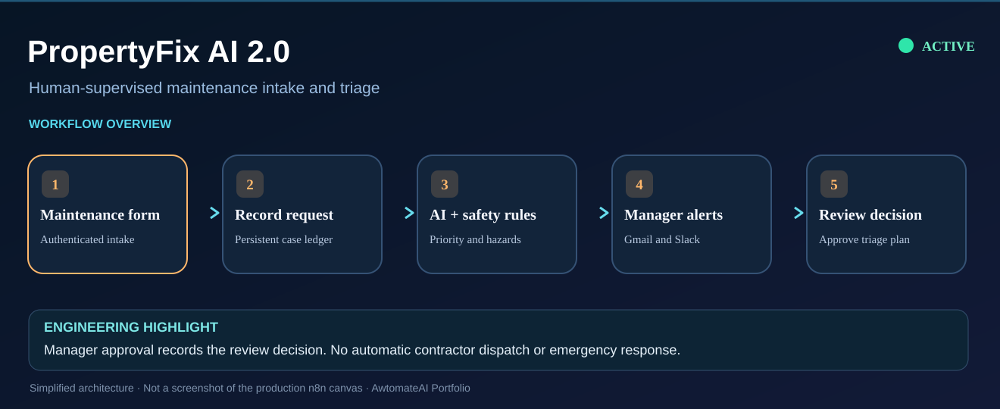

# AI Automation Portfolio

### Hi, I'm an automation builder who enjoys turning repetitive work into simpler processes.

I work with **n8n, AI tools, APIs, and JavaScript** to connect systems and make everyday business tasks easier to manage.

I started building these projects to solve practical problems: following up with leads, understanding customer messages, researching potential clients, and keeping track of requests that would otherwise get lost in an inbox. Some are running in my own business; others are working prototypes that I've built and tested as I develop my skills.

You can explore the projects below, look through the workflows, and see what I've actually tested.

**[See all projects](PROJECTS.md)** · **[Project folders](projects/README.md)** · **[My website](https://awtomateai.com)**

## Start with these projects

If you're evaluating my work for an AI automation role, start with these three practical, tested systems.

### 1. [Anna AI — Intelligent Front Desk & Business Operations Agent](projects/anna-omnichannel-receptionist)

I built Anna to connect AI customer conversations with meaningful business workflows. The working n8n pipeline handles incoming text inquiries, generates Groq-powered answers, maintains session context, and logs records in Supabase.

**Why it's worth a look:** A genuine end-to-end AI-and-database execution has been successfully tested, with an expansion path to live voice calls, appointment bookings, CRM integrations, and service workflows.

### 2. [AI Lead Management — a workflow running on my website](projects/lead-management/n8n)

I built this to handle inquiries coming through [AwtomateAI](https://awtomateai.com). A new lead enters through the website, goes through AI-assisted qualification, and moves into the response workflow. I first tried the idea in Zapier, then rebuilt it in self-hosted n8n.

**Why it's worth a look:** It connects a real website to automation and has already handled genuine inquiries. It's my clearest example of building something I actually use. It demonstrates a real website-to-automation integration, with ongoing enhancements to follow-up handling.

### 3. [PropertyFix AI 2.0 — maintenance triage with human oversight](projects/propertyfix-ai)

I built this around a practical property-management problem: how to separate a routine repair request from something that needs immediate attention. It saves each request, suggests a priority and trade, applies safety rules, and sends the case for a manager's decision.

**Why it's worth a look:** It brings together AI classification, JavaScript safety checks, persistent records, Gmail approval, and Slack alert routing. The workflow is active in n8n, and I've tested routine and emergency cases using synthetic data. It is not a verified tenant-facing emergency service.

## All nine projects

| Project | What it helps with | Current stage |
| --- | --- | --- |
| **[Anna AI — Front Desk & Operations Agent](projects/anna-omnichannel-receptionist)** | Groq-powered conversations, context management, structured responses and Supabase logging. | **Flagship project**; tested end-to-end AI inquiry handling |
| **[Intelligent Gmail Manager](projects/intelligent-gmail-manager)** | MCP-oriented Gmail search, formatting, classification design and safe cleanup previews. | **Functional Gmail assistant**; live search and security tests passed |
| **[AI Lead Management](projects/lead-management/n8n)** | Captures and qualifies inquiries from my business website; includes an earlier [Zapier version](projects/lead-management/zapier). | Live qualification for my own business |
| **[Smart Scheduler V1](projects/smart-scheduler)** | Turns confirmed appointment emails into calendar events after approval and conflict checks. | **Live in n8n**; event creation verified in testing |
| **[PropertyFix AI 2.0](projects/propertyfix-ai)** | Helps managers triage maintenance issues, spot safety concerns, and track review decisions. | **Live in n8n**; safety and notification verification ongoing |
| **[Business Opportunity Finder](projects/business-opportunity-finder)** | Researches businesses and identifies possible automation opportunities. | Tested with real research data |
| **[Customer Engagement System](projects/customer-engagement)** | Helps monitor customer concerns and organize responses. | Portfolio prototype |
| **[Business Automation Auditor](projects/business-automation-auditor)** | Reviews websites and suggests where process automation may help. | Portfolio prototype |
| **[Autonomous Job Sourcing](projects/autonomous-job-sourcing)** | Finds relevant jobs, compares requirements, and drafts applications for review. | Portfolio prototype |

[**Explore the full project stories and evidence →**](PROJECTS.md) · [Browse project folders](projects/README.md)

## How I work

I usually begin with the part of a process that's taking too much time or creating confusion. Then I sketch out the steps, connect the tools, add the logic, and test what happens when the information isn't as clean as expected.

I'm especially interested in the point where **AI helps make sense of information, but a person still makes the important decision**. You'll see that approach in projects that involve customer replies, scheduling, and maintenance requests.

### Tools I've worked with

**Automation:** n8n, Zapier, webhooks, REST APIs  
**AI:** Groq, OpenRouter, Gemini, LangChain AI Agent, AI-assisted development with Antigravity CLI and MCP, structured AI responses  
**Code and data:** JavaScript, JSON, Google Sheets, Airtable  
**Other integrations:** Gmail, Supabase, Slack, Google Calendar, Apify, Firecrawl, Crawl4AI  
**Infrastructure:** Self-hosted n8n and local development setups

## Project validation

Each project highlights the problem addressed, the tools integrated, and the functionality demonstrated through actual execution or documented tests.

The lead qualification workflow is connected to my own live website and has received actual inquiries. The Business Opportunity Finder has been tested on real research data. Smart Scheduler and PropertyFix are both active in my self-hosted n8n instance, while testing and monitoring continue. Anna's AI text-response/Supabase path and the Gmail Manager's read-only search and security-gate behavior have been verified in saved n8n executions; other capabilities are identified separately in their project documentation. The remaining projects are demonstrations or works in progress unless their README says otherwise. **These are not paid-client case studies**, and I don't claim results like revenue increases or hours saved without evidence.

If you're reviewing my work for a role or a project, I'd be glad for you to look at the workflow structure, decisions, and safeguards—not just the screenshots.

## Find me

- **GitHub:** https://github.com/sanau0716
- **AwtomateAI:** https://awtomateai.com
