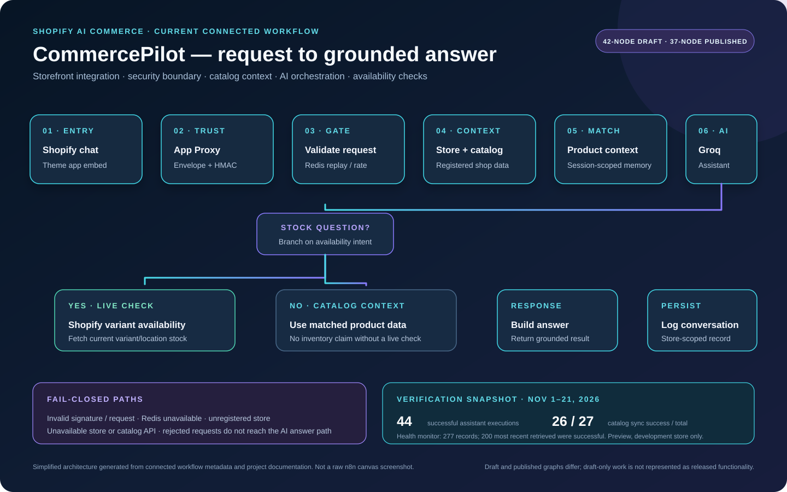
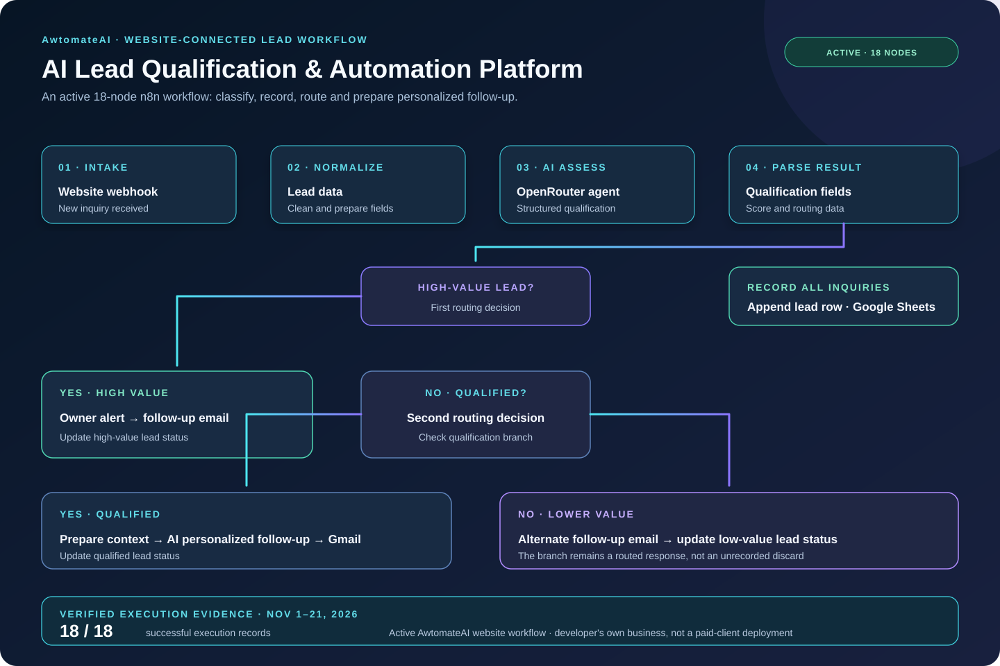
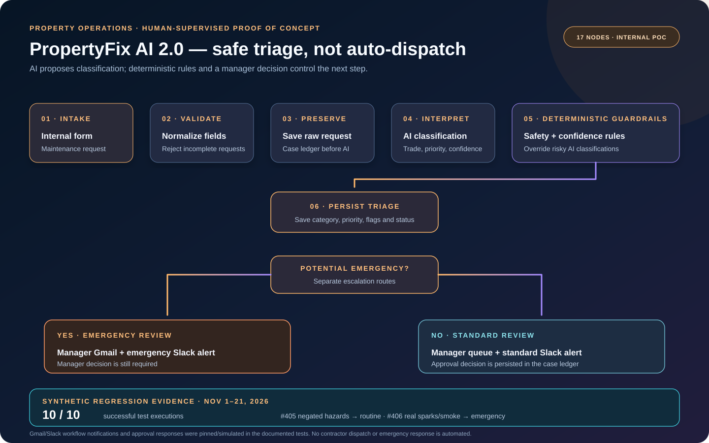
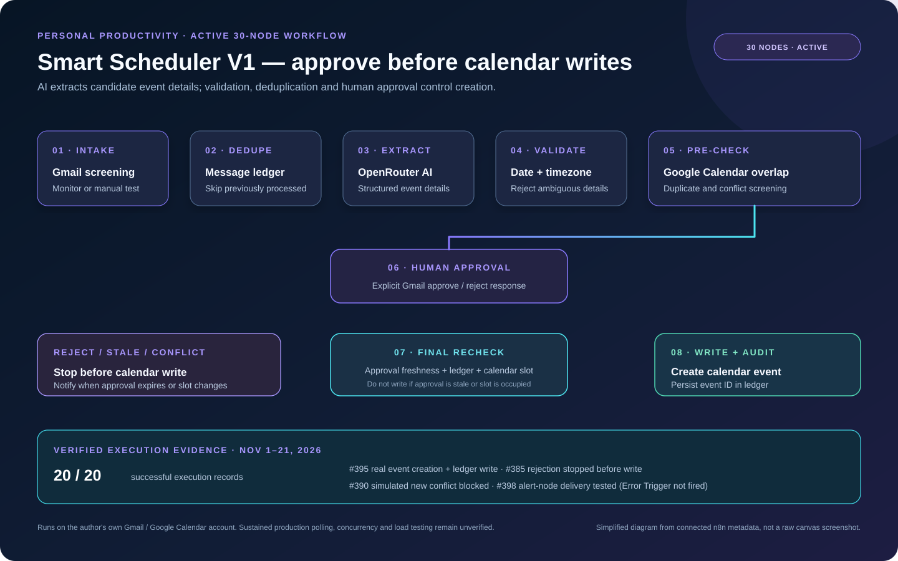
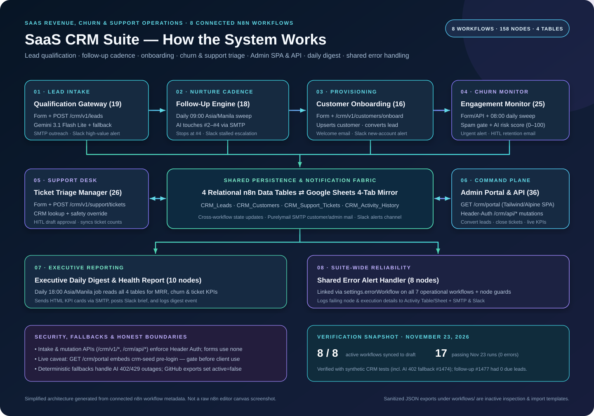
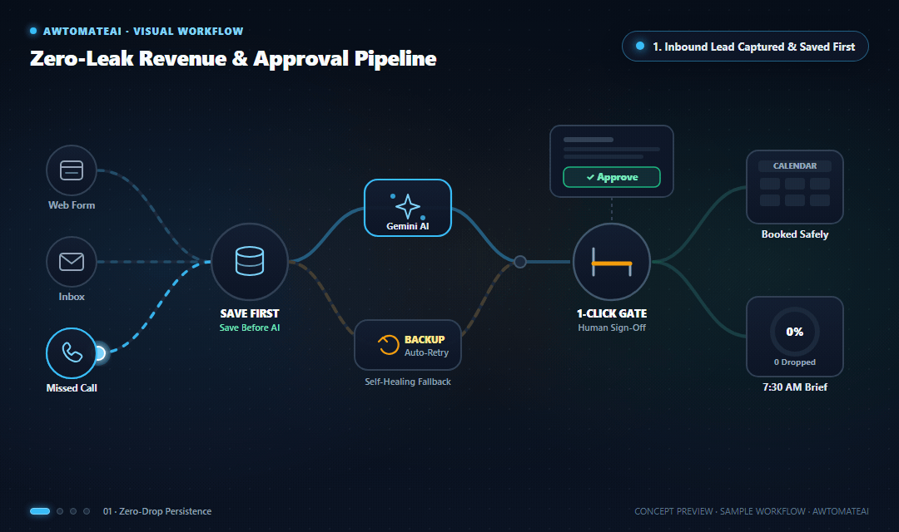
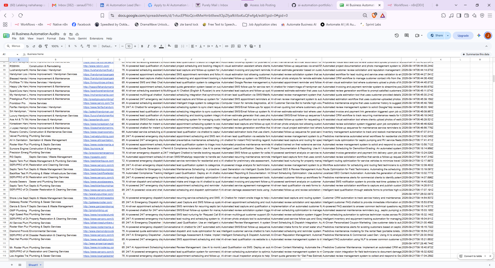
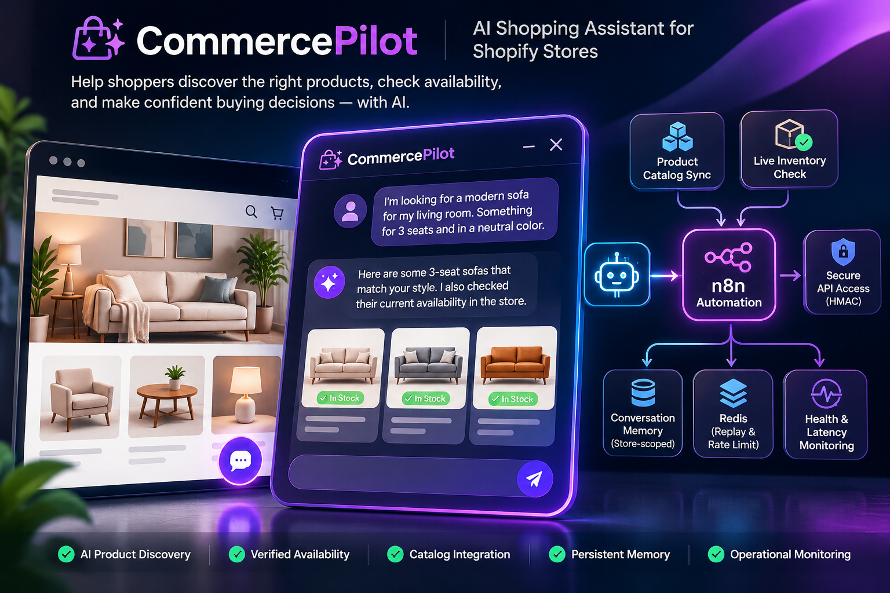

# Visual Proofs & Project Demonstrations

[← Portfolio home](README.md) · [All projects](PROJECTS.md) · [n8n workflow audit](N8N_WORKFLOW_AUDIT.md)

This page collects visual evidence for the portfolio's four featured systems. It separates **workflow architecture**, **recorded execution evidence**, **synthetic test examples**, and **promotional artwork** so a reader can tell what each visual proves.

> **Provenance:** The four workflow maps below were prepared from the connected n8n workflow metadata and project documentation reviewed on November 21, 2026. They are simplified architecture diagrams, not screenshots of the n8n editor canvas. Execution totals are read-only n8n history records; they are not uptime, revenue, conversion, or customer-outcome metrics.

## 1. CommercePilot — Shopify AI Shopping Assistant

**What this proves:** The documented request path includes App Proxy HMAC validation, request normalization, Redis replay/rate controls, store/catalog context, product matching, Groq orchestration, optional live variant availability, conversation logging, and response construction.

**Recorded evidence (November 1–21, 2026):**
- 44 successful assistant execution records.
- Catalog sync: 26 successes and 1 error across 27 records; development store only.
- Health monitor: 277 execution records; the 200 most recent records retrieved were successful.
- Current n8n draft: 42 nodes; published active version: 37 nodes. The two graphs differ, so draft-only work is not represented as released functionality.
- Shopify app Preview deployment was marked READY in the November 20 project snapshot; this is not a paid-merchant production deployment.

**Boundary:** Development-store project. Location-level inventory still requires end-to-end acceptance testing.

[Open the CommercePilot case study](projects/commercepilot)

## 2. AI Lead Qualification & Automation Platform

**What this proves:** The active 18-node website-connected workflow normalizes incoming leads, uses an OpenRouter AI agent for qualification, parses the result, records the lead in Google Sheets, and routes high-value, qualified, and lower-value paths to Gmail actions and status updates.

**Recorded evidence (November 1–21, 2026):**
- 18 successful execution records.
- Active workflow is connected to AwtomateAI website inquiries.
- The public 14-node qualification JSON is an older inactive Phase 3 snapshot. The active website workflow is a separate 18-node implementation.
- The follow-up monitor is a separate inactive workflow; its current 16-node version differs from the 15-node export.

**Boundary:** Operational on the developer's own business website; not a paid-client deployment. No conversion lift or revenue result is claimed.

[Open the AI Lead Management case study](projects/lead-management/n8n)

## 3. PropertyFix AI 2.0 — Maintenance Intelligence

**What this proves:** The 17-node workflow preserves the original request before AI analysis, applies deterministic safety and confidence rules, persists triage, separates emergency from standard manager review, and records a manager decision.

**Recorded evidence (November 1–21, 2026):**
- 10 successful execution records using synthetic test data.
- Execution #405: explicit negation (“no flooding or fire”) was handled as routine.
- Execution #406: actual sparks/smoke remained classified as an emergency.
- Gmail/Slack notifications and approval responses were pinned or simulated in the documented tests. A separate Slack credential delivery test succeeded, but delivery through the PropertyFix notification nodes still needs dedicated verification.

**Boundary:** Internal proof of concept. It does not dispatch contractors, call emergency services, or make tenant-facing safety promises.

[Open the PropertyFix case study](projects/propertyfix-ai)

## 4. Smart Scheduler V1 — AI-Assisted Email-to-Calendar

**What this proves:** The active 30-node workflow screens Gmail messages, checks a persistent ledger, extracts and validates event details, checks calendar conflicts, requests explicit approval, rechecks the ledger and calendar, then creates and records an approved event.

**Recorded evidence (November 1–21, 2026):**
- 20 successful execution records.
- Execution #395: real Gmail-to-approval-to-calendar creation and ledger persistence verified.
- Execution #385: rejected approval stopped before event creation.
- Execution #390: simulated new conflict after approval was blocked.
- Execution #398: the Gmail alert node delivered successfully; this did not fire the actual n8n Error Trigger.

**Boundary:** Runs on the developer's own Gmail and Google Calendar account. Sustained polling, concurrency, and load testing remain unverified.

[Open the Smart Scheduler case study](projects/smart-scheduler)

## 5. SaaS CRM Suite — Multi-Workflow Revenue, Churn & Support Operations

**What this proves:** Eight coordinated workflows (`158` nodes) share four n8n Data Tables (`CRM_Leads`, `CRM_Customers`, `CRM_Support_Tickets`, `CRM_Activity_History`) and a four-tab Google Sheets mirror, connecting lead qualification, daily follow-up sequences, onboarding with automatic lead conversion, churn risk monitoring, support ticket triage, an Admin Command Portal SPA/API, daily executive KPI digests, and a suite-wide error handler.

**Recorded evidence (November 23, 2026):**
- 17 successful execution records across all 8 workflows (`0` failures) using synthetic CRM records.
- Execution `#1474`: OpenRouter returned HTTP `402`; the deterministic fallback kept pipeline persistence and outreach intact without crashing.
- Execution `#1481`: Executive daily digest aggregated `$2,198` active MRR across 2 synthetic accounts into HTML email KPI cards and Slack output.
- Execution `#1477`: Follow-up engine ran cleanly and exited with `0` due leads; downstream overdue follow-up email generation remains to be tested with an aged lead.

**Boundary:** Self-hosted developer-instance implementation tested with synthetic data, not a paid-client deployment. Live `GET /crm/portal` embeds `crm-seed` before token entry and should be auth-gated before multi-tenant use.

[Open the SaaS CRM Suite case study](projects/saas-crm-suite)

## 6. Zero-Leak Revenue & Executive Guardrail Suite

**What this proves:** Five coordinated workflows (`118` nodes) combine persist-first lead capture (`ZL_Leads_Vault`), Gemini -> OpenRouter -> 15-minute DLQ self-healing recovery (`ZL_Retry_Queue`), deterministic safety overrides, bot-safe two-phase executive approval (`GET /decision` preview + `POST /commit` execution), live pre-dispatch booking conflict checks (`ZL_Bookings`), shared error alerting (`ZL_Audit_Log`), and a daily 7:30 AM `Asia/Manila` brief. *(Note: the GIF above is an engineered architecture showcase animation, not an editor screen recording.)*

**Recorded evidence (November 24, 2026):**
- 18 end-to-end verification checks executed across all 5 active workflows using synthetic prospect payloads (`0` dropped leads across `10` vault rows).
- Executions `#1706`, `#1735`, and `#1741`: verified OpenRouter primary-outage failover, total-outage DLQ capture, and multi-item `SplitInBatches` DLQ self-healing recovery (`2/2` rows marked `RECOVERED`).
- Live HTTP tests against `/webhook/zero-leak/decision` and `/webhook/zero-leak/commit`: verified `Slackbot-LinkExpanding` prefetch immunity (`200`, `mutated: false`), forged token rejection (`403`), replay lock (`409`), double-booking conflict halt (`409`), and confirmed booking dispatch (`200`).
- Execution `#1754`: delivered full Gemini Pro+ Morning Brief via SMTP (`250 2.6.0 Message received`) and Slack (`"ok": true`).

**Boundary:** Self-hosted developer-instance implementation tested with synthetic prospect records; not a paid-client production deployment. Shared error handler `00` was verified via manual test execution `#1686`.

[Open the Zero-Leak Executive Guardrail case study](projects/zero-leak-executive-guardrail)

## 7. Additional visual evidence

### Historical Business Opportunity Finder output

This existing screenshot is documented as an actual saved Google Sheets output from a historical research run using real-world business records. The AI-generated opportunity scores and recommendations are research suggestions requiring human verification. The current 19-node n8n workflow is inactive; the 17-node public JSON is an earlier snapshot.

[Open the Business Opportunity Finder case study](projects/business-opportunity-finder)

### CommercePilot showcase artwork

This is promotional showcase artwork created for a project announcement. It is **not** a screenshot of a live Shopify storefront, admin dashboard, or n8n canvas.

[Open the CommercePilot case study](projects/commercepilot)

---

## Evidence standards

- Architecture diagrams explain system design; they are not raw application screenshots.
- Execution counts are dated history snapshots, not service-level guarantees.
- Synthetic test data is labeled as synthetic.
- Simulated/pinned integrations are not described as verified live delivery.
- Preview deployments and development stores are not described as paid-merchant production deployments.
- No revenue lift, conversion improvement, customer savings, or uptime claim is made without independently supported measurements.
- Public screenshots and exports must be reviewed for credentials, private URLs, email addresses, tokens, and personal data before publication.
