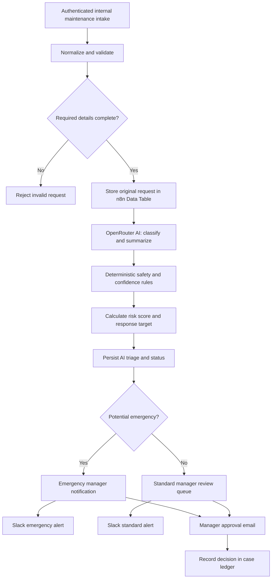

# PropertyFix AI 2.0 — Maintenance Intelligence

**Status:** Unpublished n8n portfolio proof of concept, created and tested November 11, 2026. **Not** a live tenant-facing service or verified contractor-dispatch system.

**Stack:** Self-hosted n8n · n8n Form Trigger · n8n Data Tables · OpenRouter LLM · JavaScript · Gmail · Slack

## Business problem

Property managers receive maintenance requests in unstructured messages and forms. Reviewing every issue, identifying a suitable trade, separating immediate hazards from ordinary jobs, and tracking the case can consume staff time. A rushed automation can also make dangerous mistakes by silently down-ranking hazards or suggesting that help has been sent when it has not.

## What I built

**PropertyFix AI 2.0** is a 17-node, human-supervised maintenance intake and triage workflow. It captures a request, preserves the original submission in a persistent case ledger, uses AI to summarize the issue and suggest a relevant trade, applies deterministic safety overrides, and generates manager-facing review notifications followed by an explicit approve/reject decision that is saved in the ledger. It assigns **illustrative** response targets and risk scores without claiming to have dispatched anyone.

The project builds on my earlier *PropertyFix AI* maintenance-automation concept. It is a **new n8n implementation**; the original Zapier source files have not been verified within the connected GitHub repository.

## Workflow architecture

## Features relevant to property-management teams

| Capability | How it works |
| --- | --- |
| Structured request intake | Resident name and email, property, unit, category, and issue description |
| Input validation | Rejects requests without essential fields or valid email format |
| Original request preservation | Persists a capped JSON copy of the input *before* AI analysis |
| AI-assisted triage | Suggests priority, trade, summary, safety flags, reasoning, and confidence |
| Safety overrides | Recognized gas, electrical, smoke/fire, flooding, and structural hazards are elevated regardless of AI output |
| Confidence fallback | Low-confidence classifications go to manual triage instead of being silently auto-approved |
| Case management | Data Table persists identifier, status, source details, AI decisions, and timestamps |
| Operational targets | Illustrative targets: emergency 5 minutes, urgent 60 minutes, routine 24 hours, uncertain 120 minutes |
| Review queues | Routes potential emergencies separately from ordinary manager reviews |
| Human decision checkpoint | Gmail approval/rejection form followed by persistent decision status |
| Slack alerts | Separate emergency and standard manager notification routes; no resident names or email addresses in channel messages |
| AI data minimization | AI prompts include issue category and description, not resident contact details or the saved raw payload |
| AI failure fallback | Classification errors route toward manual review rather than silently disappearing |
| Emergency acknowledgment | Approved emergency triage remains marked `emergency_review_acknowledged`, not resolved or dispatched |
| Guardrails | No autonomous contractor assignment, emergency-service call, or tenant promise is made |

**Response targets are demonstration configuration values, not contracted SLAs.** A property manager must configure real service policies, staffed coverage, and local emergency procedures before using them operationally.

## Verified proof-of-concept executions

All data used in the following tests was synthetic:

- **Execution #399:** A slowly dripping faucet was saved, categorized as routine plumbing, and sent to the simulated standard manager notification branch.
- **Execution #400:** Smoke and sparking at an electrical panel were classified as emergency electrical work, persisted as requiring immediate review, and routed to the simulated emergency notification.
- **Execution #401:** The electrical hazard was re-tested after response-target enhancements. The saved record contained emergency priority, risk score 100, a five-minute illustrative response target, and explicit recommended human action.

- **Execution #402:** Human approval response was simulated and the manager decision was saved to the ledger. This also surfaced a **known bug**: the phrase “no flooding” falsely triggered an emergency due to keyword matching. The negation check was subsequently corrected and retested in executions **#405** and **#406**.

- **Execution #405:** Correctly treated “no flooding or fire” as a routine maintenance case and persisted an approved triage-plan decision (simulated).
- **Execution #406:** Correctly retained emergency classification for real sparks/smoke and persisted an approved triage-plan decision (simulated).
- **Execution #409:** Routine plumbing with explicit negation was classified as routine, its manager approval persisted, and the standard Slack route executed with simulated delivery.
- **Execution #410:** Sparks and smoke were classified as emergency, the dedicated Slack emergency route executed with simulated delivery, and an approved manager review persisted as `emergency_review_acknowledged`.

Gmail notifications, Slack notifications, and approval responses were **pinned/simulated** during these tests. The Slack credential itself was independently verified via a successful real delivery test (#407), but live PropertyFix Slack delivery and the AI error branch still require dedicated testing. Live notification delivery, production form access controls, broad natural-language negation handling, actual emergency response, concurrent submissions, and sustained operational performance have **not** been verified.

## Data handling and safety

This GitHub documentation contains no real resident data, credential IDs, private API tokens, form URLs, or internal database identifiers. The form is configured for authenticated n8n users in the draft. Before any tenant-facing deployment, the design needs a dedicated resident authentication strategy, data-retention policy, access controls, consent/privacy review, rate limiting, event logging, and emergency escalation procedures.

## Next engineering milestones

1. Expand safety-rule tests beyond the verified “no flooding or fire” example, including tricky negations and multiple hazards; deterministic keyword rules remain an imperfect heuristic.
2. Extend the existing approval decision into a work-order state machine (assigned / in-progress / completed / rejected).
3. Build duplicate detection for near-identical requests and safe update/reopen behavior.
4. Add vendor skills, location, availability, and cost-aware dispatch **recommendations** rather than automatic dispatch.
5. Add SLA aging, escalation reminders, and an operations dashboard.
6. Test the AI failure-output branch with explicit failure injection and verify notification delivery through the actual PropertyFix nodes.
7. Test low-confidence cases, false-positive hazards, failed LLM calls, duplicates, and volume/concurrency.
8. Export a sanitized workflow JSON and add screenshots after reviewing for credentials and private configuration.

---

**Portfolio disclosure:** Independently developed proof of concept for my automation portfolio, not a paid client deployment. No unverified efficiency gains, revenue, uptime, or contractor-response outcomes are claimed.
