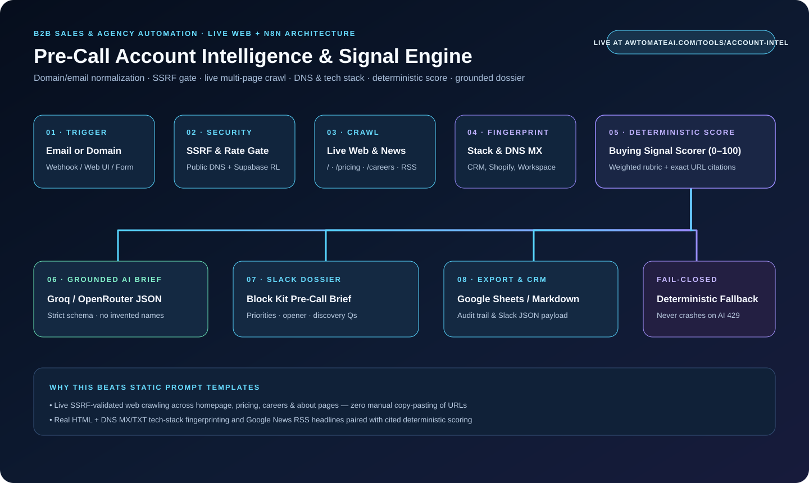

# Pre-Call Account Intelligence & Signal Engine

[← Portfolio](../../README.md) · [Live Interactive Tool](https://www.awtomateai.com/tools/account-intel) · [Sanitized n8n Workflow](workflow/b2b-account-intelligence-brief.json)

**Stage:** Live interactive web tool at [awtomateai.com/tools/account-intel](https://www.awtomateai.com/tools/account-intel) (`Next.js` + `TypeScript` + `Groq` + `Supabase` rate limiting) paired with a sanitized n8n workflow template for automated Slack/CRM delivery.

## Problem & Why This Beats Prompt-Only Research Skills

Static LLM prompt templates require a sales rep or agency founder to manually copy URLs, pricing pages, and notes into a chat window—and still risk hallucinated company facts or invented names.

This system replaces manual prep with an **automated, citation-backed pipeline**:

1. **Accepts any B2B domain or work email** (`stripe.com` or `maya@linear.app`).
2. **Enforces SSRF & rate-limit gates** (resolves DNS first, blocks loopback/RFC1918/link-local/cloud-metadata IPs, and enforces per-visitor HMAC rate limits in Supabase Postgres).
3. **Crawls live public pages** (`/`, `/pricing`, `/careers`, `/about`) + **Google News RSS**.
4. **Fingerprints real tech stacks & DNS** (`Shopify`, `HubSpot`, `Intercom`, `Zendesk`, `Salesforce`, `Stripe`, `Calendly`, `Next.js`, `Google Workspace` / `Microsoft 365` via MX & SPF records).
5. **Scores buying & automation signals deterministically (0–100)** with exact URL citations.
6. **Builds a grounded 1-page pre-call brief + Slack Block Kit JSON** (with a deterministic fallback if the LLM endpoint hits rate limits).

## Architecture

| Layer | Live Implementation (`awtomateai.com`) | n8n Template Equivalent |
|---|---|---|
| Input & Safety | Domain/email parser + DNS public-IP SSRF checks + Supabase RPC rate limiter | Header-Auth Webhook + JavaScript safety gate |
| Multi-Source Crawl | Parallel `fetch()` across `/`, `/pricing`, `/careers`, `/about` + Google News RSS | Parallel `HTTP Request` nodes with `continueOnFail` |
| Stack Detection | HTML signature matcher + `node:dns/promises` MX/TXT lookup | JavaScript Code node signature matcher |
| Signal Scoring | Deterministic 5-factor rubric (`0–100`) citing verified URLs | Deterministic Code node rubric |
| AI Synthesis | Groq structured JSON (`openai/gpt-oss-20b`) + deterministic fallback | Groq / OpenRouter HTTP Request + fallback formatter |
| Output | Interactive web UI + Copy Markdown + Copy Slack Block Kit JSON | Slack channel alert + Webhook JSON response |

## Honest Boundaries

- Only inspects **publicly reachable HTML pages**, DNS records, and public Google News RSS—it does not scrape behind LinkedIn authwalls or private CRMs unless supplied via user call notes.
- If a target site blocks automated HTTP requests (`403` / JS-only challenge), the tool returns an explicit message rather than bypassing anti-bot controls.
