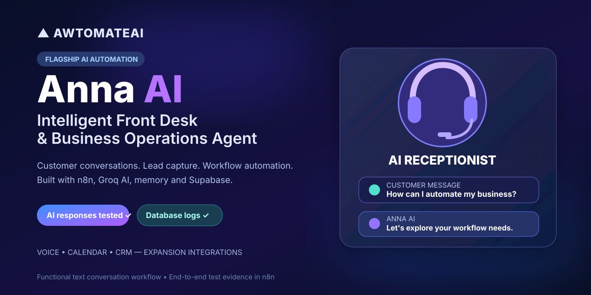
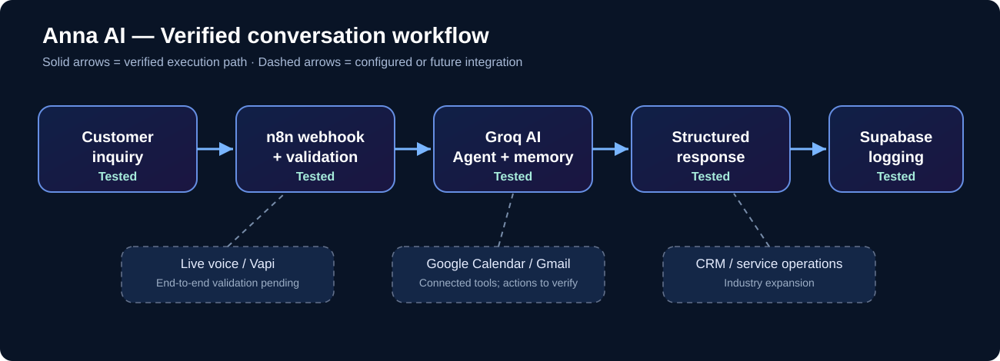

# Anna AI — Intelligent Front Desk & Business Operations Agent



**AwtomateAI flagship project · Functional AI receptionist · Successfully tested with actual n8n executions**

Anna is a conversational AI and workflow orchestration system built to reduce repetitive front-desk work: answering inquiries, collecting lead information, preparing business actions and preserving an auditable record of customer conversations. It combines **self-hosted n8n, a Groq-powered AI Agent, session memory and Supabase**, with connected Google Calendar and Gmail tools.

## Business problem and solution

Service businesses repeatedly handle the same questions, enter caller details manually, coordinate bookings, and forward requests to colleagues. Anna creates a path from **customer conversation → AI understanding → structured response and business records**, with business-specific tools ready for further integration.

| Repetitive business task | Anna's workflow role |
| --- | --- |
| Service and pricing questions | Generate relevant, natural-language answers without manually answering each inquiry |
| Initial lead intake | Collect customer intent, contact details and session context |
| Data entry | Write structured inquiry and AI-response records to Supabase |
| Appointment requests | Gather booking details and route to Google Calendar tooling (end-to-end action test pending) |
| Escalations | Route handoff requests to Gmail tooling (delivery verification pending) |
| Voice calling | Normalize voice-channel/transcript inputs; live Vapi end-to-end validation pending |

## Architecture



**Verified core:** Webhook intake → input validation → Groq AI Agent with session memory → customer response, with Supabase persistence.

**Implementation stack:** n8n, Groq (`openai/gpt-oss-20b` in the inspected workflow), LangChain AI Agent, Window Buffer Memory, Supabase, JavaScript, webhook header authentication, Google Calendar tools and Gmail tools. The voice integration direction includes Vapi, but end-to-end live calling is a separate validation milestone.

## Evidence: functional and successfully tested

The project includes recorded n8n execution results, including repeated test and debugging runs. The strongest verified run is:

| Execution | Recorded outcome |
| --- | --- |
| **#440** | **Successful:** customer inquiry received at webhook; validation passed; Groq generated a service explanation; Supabase accepted the inquiry and response; webhook response node completed |
| **#439** | Successful manual demonstration and database-reading test |
| **#423** | Successful rule-based fallback demonstration |

This demonstrates functioning AI responses and persisted records, not just a workflow mockup. The workflow is currently inactive, preventing unreviewed live business transactions.

## Portfolio demonstration script

Use non-sensitive sample customer data and a safe test environment. For the **verified text path**, demonstrate:

1. Submit a test message: **“Hello Anna! What automation services does AwtomateAI offer?”**
2. Show the validated request entering the n8n AI Agent and Groq model.
3. Show Anna's generated response describing relevant automation services.
4. Show the completed record in Supabase and returned JSON response.
5. Explain how a calendar booking, CRM record or staff alert can be added as a *separately validated* business action.

### Example chat input

```json
{
  "channel": "web_chat",
  "session_id": "portfolio-demo-001",
  "message": "What automation services does AwtomateAI offer?",
  "customer": {
    "name": "Demo Customer",
    "email": "demo@example.test"
  }
}
```

Webhook requests require the configured authentication header; never publish the secret. The example above documents the input format and is not a publicly runnable endpoint.

## Industry application opportunities

- **Home services:** inbound service requests, initial issue details, follow-up routing
- **Property management:** tenant inquiries, maintenance intake, leasing questions
- **Real estate:** property questions, viewing requests, sales-lead qualification
- **Professional services:** appointment inquiries and structured handoffs

These are customization scenarios, not claims that all industry-specific workflows have already been deployed.

## Next engineering milestones

**Live calling:** Vapi → authenticated n8n tool endpoint → verified voice response.  
**Transactional actions:** Calendar create/reschedule tests, safe Gmail escalation tests, and CRM/work-order integration.  
**Operational hardening:** dedicated conversation storage, privacy controls, monitoring, exception handling and structured audit logs.

**Portfolio scope:** Independently engineered and tested AwtomateAI demonstration, with verified text conversation and Supabase persistence.

[View the other projects](../../PROJECTS.md) · [AwtomateAI website](https://awtomateai.com)
