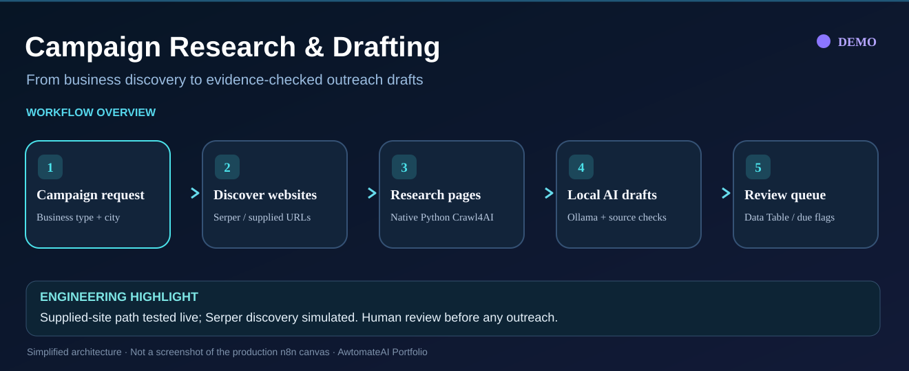
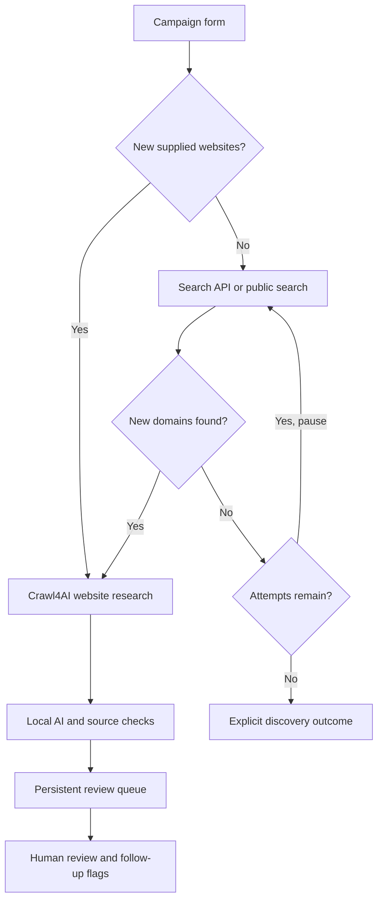

# Campaign Research & Drafting Agent

[← Portfolio](../../README.md) · [Setup](docs/setup.md) · [Validation](docs/validation.md)

**Status:** Internal research prototype. Real end-to-end research and drafting verified with a supplied business website. Serper discovery tested with simulated responses; a live Serper acceptance test remains outstanding. Both exported workflows are inactive.

## Overview

I built this system for AwtomateAI to research potential customers and prepare relevant outreach drafts while keeping model inference on my own computer. The design separates search, website evidence, AI drafting and human review, so a search result is never treated as proof that a business needs automation.

A form inside n8n offers 15 business categories plus an **Other business or service** option. Users choose a city, describe their offer, and request one, three or five businesses. Company websites are optional: new supplied domains bypass discovery; blank or already-known domains initiate a bounded search loop.

This project demonstrates practical AI implementation: a usable intake form, API orchestration, a small local language model, deterministic source checks, persistence and explicit failure outcomes. It replaces the Apify discovery dependency for this project with Serper, while native Python Crawl4AI handles website reading without Docker Desktop.

## Architecture & Tech Stack

| Component | Implementation |
| --- | --- |
| Intake | n8n Form Trigger; category dropdown, custom option, location and offer |
| Business discovery | Serper Google Search API; optional public-search fallback |
| Website research | Crawl4AI through a small project-specific Python REST adapter |
| AI assessment and drafting | Local Ollama `hermes3:3b`, requested as JSON |
| Validation | JavaScript checks source quotations, business category and service area |
| Persistence | Shared n8n Data Table, keyed by normalized business domain |
| Review | Separate manual workflow calculates follow-up flags |
| Local runtime | Windows PowerShell, Python and Chromium; no Docker required |

## Key Workflow Logic

1. Normalize the campaign form, including custom categories and public website URLs.
2. Create or reuse the shared queue, then read existing domains to avoid researching the same business again. Run one campaign at a time; this is not an atomic concurrent deduplication service.
3. Use new supplied websites or search for candidates. Discovery rotates queries/pages, pauses between attempts and stops after six attempts by default. A blocked provider is skipped for the rest of that run.
4. Research company homepages and selected contact pages on the same domain. Capture public contact details with source URLs.
5. Ask Ollama for a decision, exact source quotations, an opportunity hypothesis and introduction/follow-up drafts. Process AI requests sequentially to reduce peak resource use.
6. Verify quotations against retrieved text and require evidence for the selected business type and service area. Unsupported claims or invalid model output result in skipped/error records.
7. Insert new queue entries without overwriting earlier contact history. Accepted drafts start as `NEEDS_REVIEW`.
8. Run the review workflow to calculate a follow-up date five days after a manually recorded `CONTACTED` timestamp. `REPLIED`, `FOLLOWED_UP` and `DO_NOT_CONTACT` do not receive due flags.

Neither workflow sends email, makes calls, posts content or monitors replies. Follow-up flags depend on manually maintained statuses. The discovery loop stops when it finds new candidate websites; it does not continue automatically until an AI-approved draft is produced.

## Setup & Configuration Notes

Import both [workflow exports](workflows), reconnect your own Crawl4AI and Serper credentials, and configure local endpoint URLs and sender details. The included [local Crawl4AI adapter](local-crawl4ai) supplies the specific response shape these workflows expect; it is not the official Crawl4AI Docker server. Follow the [setup guide](docs/setup.md) before testing.

Start with one business on a modest computer. Local inference still uses CPU/RAM and can take several minutes. Search API calls consume query credits; Crawl4AI page reads and Ollama drafting do not consume Serper credits. Public search may be blocked by robots rules or CAPTCHA, which the workflow reports explicitly rather than claiming no businesses exist.

Credential bindings, webhook identifiers, execution data and pinned samples are excluded. Form paths and sender defaults are reset for import. The workflow logic and node versions otherwise reflect the source snapshot of November 17, 2026. See [validation evidence and limitations](docs/validation.md).
