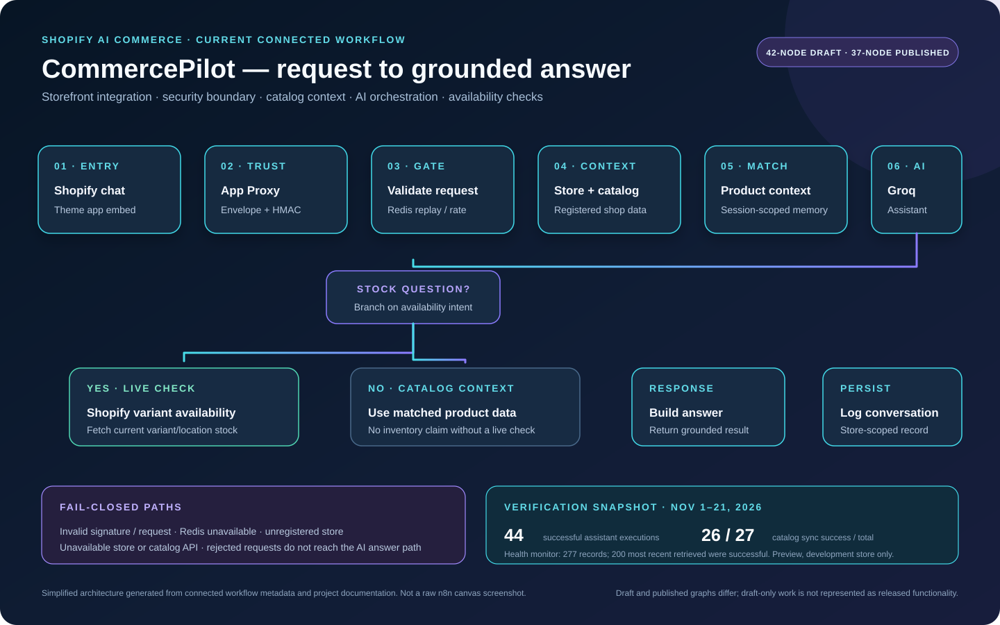

# CommercePilot — Shopify AI Shopping Assistant

**Flagship platform project · Shopify app + n8n AI orchestration · Preview stage**

CommercePilot is a Shopify-first AI shopping assistant designed to help customers discover products using a merchant's own catalog and current Shopify availability. The project combines a storefront integration, protected app/API routes, n8n orchestration, an LLM agent, store-scoped conversation context, and operational monitoring.

This public case study documents the engineering work without publishing private source code, merchant identifiers, live webhook URLs, credentials, or execution payloads.

## Business problem

Large product catalogs can make product discovery difficult. A generic chatbot may answer conversationally but lack reliable access to a store's actual products, variant options, inventory, or location availability.

CommercePilot is designed to ground shopping conversations in the connected Shopify store rather than inventing product details or stock.

## System architecture

~~~mermaid
flowchart TD
    A[Shopify storefront chat embed] --> B[Shopify App Proxy]
    B --> C[App Proxy envelope + HMAC verification]
    C --> D[Request normalization and validation]
    D --> E[Redis replay and rate-limit checks]
    E --> F[Registered store and catalog context]
    F --> G[Product matching]
    G --> H{Stock or availability question?}
    H -- Yes --> I[Live Shopify variant availability]
    H -- No --> J[Continue with catalog context]
    I --> K[Groq AI shopping assistant]
    J --> K
    M[Store-scoped session memory] -.-> K
    K --> L[Build catalog-grounded response]
    L --> N[Save conversation]
    N --> P[Return response to storefront]
    O[Health and latency monitor] -.-> K
    O -.-> E
    O -.-> B
~~~

## Main components

### 1. Shopify storefront and app

- Shopify Theme App Extension for the storefront chat entry point.
- Shopify App Proxy route for store-originated requests.
- Shopify React Router app with authenticated admin routes.
- Shopify Admin GraphQL queries for store context, product data, variants, and availability.
- Supabase/PostgreSQL persistence through Prisma models and protected internal API routes.
- Vercel Preview deployment for the app.

### 2. n8n AI shopping assistant

The active Groq-based n8n workflow includes request normalization, registered-store checks, product matching, an AI Agent, store-scoped session memory, response construction, conversation logging, and webhook responses.

The workflow also includes:
- Shopify App Proxy envelope normalization and HMAC verification.
- Redis-backed replay/rate-limit checks.
- Catalog and store API retrieval.
- On-demand live Shopify variant availability checks for stock questions.
- Response-duration measurement and slow-response alert routing.
- Explicit rejection paths for invalid requests, unregistered stores, failed signature checks, and unavailable security services.

### 3. Catalog and inventory synchronization

The separate catalog-sync workflow:
- Fetches Shopify products through cursor-based pagination.
- Handles large snapshots in bounded batches.
- Validates the returned snapshot before reconciling records.
- Upserts catalog rows and soft-deactivates products missing from a complete snapshot.
- Is explicitly configured for the development store only.

The Shopify app Preview branch also adds location-level inventory synchronization. The implementation reads active inventory levels and location names from Shopify, persists the variant/location relationship, records sync status, and surfaces inventory grouped by location in the app dashboard.

The location-level inventory code is committed to the Preview branch and the corresponding Vercel deployment is READY. End-to-end validation against the connected Shopify development store remains a required next test.

### 4. Reliability and monitoring

The active health monitor runs every five minutes and checks:
- Groq API availability.
- Upstash Redis availability.
- Public n8n tunnel health.
- Shopify Admin API authentication.
- Response latency and transition-based alert conditions.

A separate error workflow handles n8n workflow-failure notifications. A successful test execution is recorded; this is not represented as proof that every production failure path has been exercised.

## Security and engineering decisions

- Validate the Shopify App Proxy signature before accepting storefront requests.
- Normalize and validate request payloads before invoking the AI workflow.
- Check that the shop is registered and active.
- Use Redis to limit replay and abusive request patterns.
- Keep conversation memory scoped to the store/session.
- Retrieve products from the merchant's catalog rather than asking the model to invent inventory.
- Query live variant availability when stock questions require it.
- Log conversation records through the app's store-scoped APIs.
- Keep private credentials and merchant configuration outside the public portfolio.

## Verification snapshot — November 21, 2026

| Component | Observed evidence | Boundary |
|---|---|---|
| Storefront Shopping Assistant API (Groq) | 44 successful execution records in the Nov 1–21 history snapshot | Current draft is 42 nodes; published active version is 37 nodes; the graphs differ |
| Shopify Catalog Sync | 26 successful and 1 failed execution across 27 records | Development-store-only workflow |
| Health & Latency Monitor | 277 total records in the Nov 1–21 query; the 200 most recent retrieved records succeeded | The remaining 77 records were not individually retrieved in this query; monitoring runs do not establish an uptime SLA |
| Error Alert Handler | One successful manual test | This does not prove a real production error-trigger event was handled |
| Shopify app Preview | Vercel deployment marked READY for commit b72b0fc0324d60c0d10e592626f468cf0bbbe6fe on branch commercepilot/preview-setup | Preview, not Production |
| Location-level inventory work | Schema migration and Preview code committed | Full Shopify location-sync acceptance test still pending |

## Draft vs published release boundary

The connected n8n workflow is active, but its current draft and published active version are not the same graph:

| Version | Node count | What to understand |
|---|---:|---|
| Current draft | 42 | Includes newer store/catalog API retrieval and conversation load/save nodes |
| Published active version | 37 | Uses a different registered-store, active-product, conversation-log, and session-recommendation node set |

The 44 execution records are history evidence for the workflow ID; they should not be used to claim that every capability visible in the current draft is already published. Draft-only changes must be published and tested before being described as released storefront behavior.

The updated [architecture visual](assets/workflow-overview.svg) summarizes the system at a component level and explicitly calls out this release boundary. It is generated from connected workflow metadata and project documentation, not captured from the n8n canvas.

## Current limitations

- Development-store implementation; no paid-merchant deployment is claimed.
- The active n8n assistant's published version is behind its current draft; draft-only features must be published and tested before being described as live.
- Catalog sync is development-store-only and is not yet a general self-service merchant onboarding flow.
- Location-level inventory sync requires end-to-end validation against Shopify.
- No verified revenue, conversion uplift, customer adoption, or time-saved metrics are claimed.
- Public distribution, merchant billing, self-service onboarding, and commercial multi-tenant readiness are future milestones.

## Technologies

Shopify Admin GraphQL · Shopify App Proxy · Shopify Theme App Extension · React Router · TypeScript · Prisma · Supabase/PostgreSQL · n8n · Groq · Upstash Redis · Vercel · JavaScript.

## Source and privacy

The Shopify app source is maintained in a separate private repository. This public folder is a technical case study, not a runnable export. Internal API paths, webhook URLs, store IDs, credentials, and merchant data are intentionally omitted.

[← Back to portfolio](../../README.md) · [All projects](../../PROJECTS.md) · [n8n workflow alignment audit](../../N8N_WORKFLOW_AUDIT.md)
