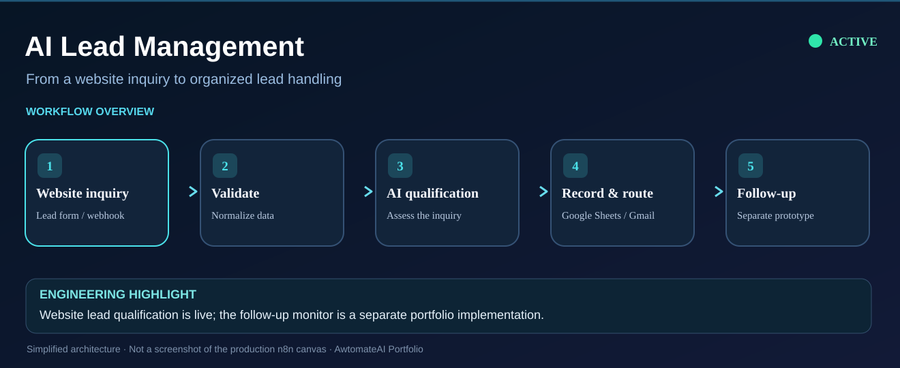

# AI Lead Management System



*Simplified diagram of the lead-handling workflow. The deployed lead qualification and prototype follow-up work are distinguished below.*

**Deployment:** The current AI lead qualification workflow is active in n8n and connected to my business website. The separate follow-up monitor in this repository is a prototype, not a claim of live deployment.

An n8n-based AI automation project for lead qualification, personalized responses, scheduled follow-ups, and manual review escalation.

## Project Overview

This project contains two complementary workflows with 29 nodes in total.

The workflows demonstrate how AI and business automation can support lead intake, qualification, communication, and follow-up management.

## Workflow 1: AI Lead Qualification and Response

**File:** `phase-3-lead-qualification-response.json`

**Nodes:** 14

### Workflow Components

1. Receive incoming lead data through an n8n webhook.
2. Process the lead using an AI qualification agent.
3. Use Gemini 2.5 Flash-Lite through the OpenRouter integration.
4. Parse the AI qualification result using a JavaScript Code node.
5. Store qualification information in Google Sheets.
6. Route leads according to high-value and qualification conditions.
7. Send Gmail notifications and follow-up messages.
8. Update lead status in Google Sheets.

### Technical Capabilities

- Webhook-triggered automation
- AI-assisted lead qualification
- Structured result processing
- Conditional lead routing
- Automated email communication
- Google Sheets data integration

## Workflow 2: AI Lead Follow-Up Monitor

**File:** `phase-3-lead-follow-up-monitor.json`

**Nodes:** 15

### Workflow Components

1. Run automatically using an n8n Schedule Trigger.
2. Retrieve lead records from Google Sheets.
3. Filter eligible leads using JavaScript.
4. Determine follow-up eligibility and sequence.
5. Apply a four-follow-up limit.
6. Escalate leads requiring manual review.
7. Generate follow-up strategies using an AI agent connected to OpenRouter.
8. Send follow-up messages through Gmail.
9. Check email-send results.
10. Update follow-up status and activity logs in Google Sheets.

### Technical Capabilities

- Scheduled workflow execution
- Lead filtering and eligibility logic
- AI-assisted follow-up planning
- Automated email delivery
- Follow-up sequence limits
- Manual review escalation
- Activity logging
- Email failure status handling

## Technology Stack

| Technology | Purpose |
|---|---|
| n8n | Workflow orchestration |
| Webhooks | Lead intake |
| OpenRouter | AI model connectivity |
| Gemini 2.5 Flash-Lite | Lead qualification model |
| AI Agents | Qualification and follow-up strategy |
| JavaScript | Parsing, filtering, and business logic |
| Gmail | Notifications and lead communication |
| Google Sheets | Lead records, statuses, and activity logs |

## Architecture

```text
Incoming Lead
     |
     v
Webhook Trigger
     |
     v
AI Qualification
     |
     v
Parse AI Result
     |
     v
Google Sheets
     |
     v
Conditional Lead Routing
     |
     +-- High-Value Lead
     |       |
     |       +-- Owner Alert
     |       +-- Lead Follow-Up
     |
     +-- Qualified Lead
     |       |
     |       +-- Lead Follow-Up
     |
     +-- Low-Value Lead
             |
             +-- Lead Follow-Up


Scheduled Follow-Up Monitor
     |
     v
Retrieve Leads from Google Sheets
     |
     v
Eligibility and Sequence Checks
     |
     +-- Follow-Up Limit Reached
     |       |
     |       v
     |   Manual Review
     |
     +-- Eligible for Follow-Up
             |
             v
       AI Follow-Up Strategy
             |
             v
       Gmail Communication
             |
             v
       Status and Activity Updates
```

The diagram summarizes the workflow connections and does not represent every internal branch.

## Reliability and Operational Considerations

The exported workflows contain:

- Conditional routing for lead qualification.
- Scheduled follow-up eligibility checks.
- A four-follow-up limit and manual review path.
- Email-send result checks and failure status updates.

Potential improvements include:

- Persisting incoming leads before AI processing.
- Adding AI provider retry and fallback handling.
- Verifying Gmail error detection and status updates.
- Adding centralized workflow error monitoring.

## Project Status

### Live Business Deployment

The AI Lead Qualification and Response workflow is deployed on **awtomateai.com**, where website inquiries trigger a self-hosted n8n automation.

The website has received real inquiries. This is an operational deployment for the developer's own business, not a paid client implementation.

The live workflow uses AI-assisted qualification, conditional lead routing, Gmail communication, and Google Sheets integration as represented in the exported workflow.

### Portfolio Implementation

The AI Lead Follow-Up Monitor is a separate portfolio workflow and is not currently part of the live website deployment.

### Limitations

No claims are made regarding paying clients, conversion rates, measured ROI, or guaranteed production uptime. The exported workflows may differ from their currently deployed configurations.

## Skills Demonstrated

- AI workflow development
- API-connected AI model integration
- Webhook automation
- JavaScript data processing
- Conditional business logic
- Email automation
- Scheduled follow-up orchestration
- Google Sheets integration
- Human review escalation