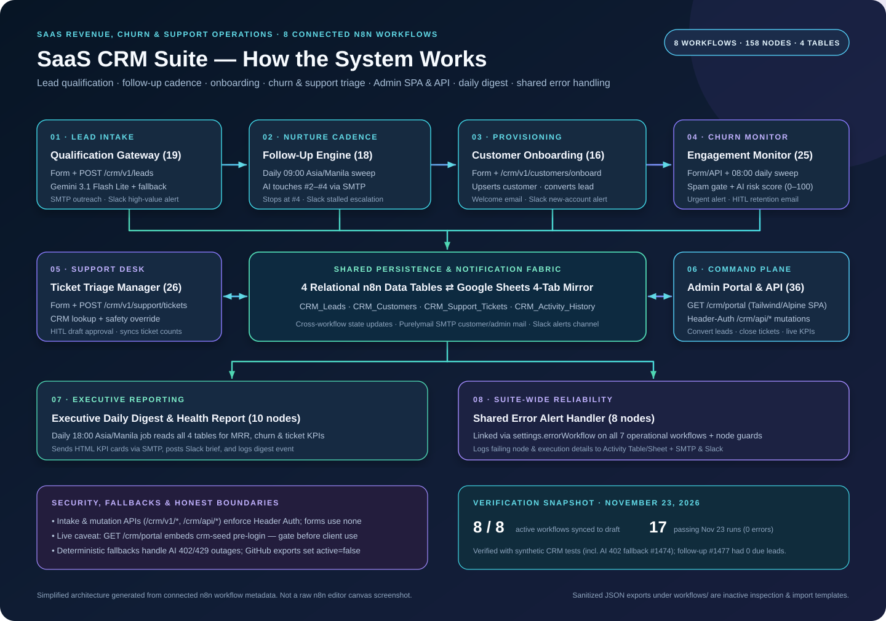

# SaaS CRM Suite — Multi-Workflow Revenue, Churn & Support Operations

[← Portfolio home](../../README.md) · [All projects](../../PROJECTS.md) · [Visual proof gallery](../../VISUAL_PROOFS.md) · [n8n workflow audit](../../N8N_WORKFLOW_AUDIT.md)

**Stage:** Active 8-workflow system on self-hosted n8n (`158` total nodes) verified on November 23, 2026 with synthetic CRM records. This unified suite supersedes the older standalone Phase 1–3 prototypes (`customer-engagement` and `lead-management/n8n` snapshots) while adding customer onboarding, an Admin Command Portal SPA/API, an executive daily digest, and a suite-wide error handler.

## Business problem & system design

Standalone intake scripts break down when lead scoring, multi-touch follow-ups, account provisioning, churn monitoring, and support triage operate in disconnected spreadsheets.

The **SaaS CRM Suite** coordinates **8 modular n8n workflows** around **4 shared relational Data Tables** and a **4-tab Google Sheets mirror** (`Leads`, `Customers`, `Support_Tickets`, `Activity_Log`), backed by OpenRouter structured AI chains, deterministic safety overrides, human-in-the-loop (HITL) SMTP approvals, Slack operational alerts, and a live Admin Command Portal.

## How the 8 workflows work together

| # | Workflow | Nodes | Trigger / Entry | Persistence & Integrations | Verified Nov 23 Runs | Sanitized Export |
|---|---|---:|---|---|---:|---|
| 1 | **Lead Intake & Qualification Gateway** | 19 | Web Form + Header-Auth `POST /crm/v1/leads` | OpenRouter (`google/gemini-3.1-flash-lite`) + deterministic fallback, `CRM_Leads`, Google Sheets, Purelymail SMTP, Slack | 3 / 3 | [01-lead-intake-qualification-gateway.json](workflows/01-lead-intake-qualification-gateway.json) |
| 2 | **Automated Follow-Up Sequence Engine** | 18 | Schedule `09:00 Asia/Manila` + Manual | `CRM_Leads` (touches #2–#4), OpenRouter AI copywriter, Purelymail SMTP, Slack manual review alert | 1 / 1 *(0 due leads)* | [02-automated-follow-up-sequence-engine.json](workflows/02-automated-follow-up-sequence-engine.json) |
| 3 | **Customer Onboarding & Account Provisioning** | 16 | Web Form + Header-Auth `POST /crm/v1/customers/onboard` | Upserts `CRM_Customers`, auto-converts matching `CRM_Leads`, Google Sheets, Welcome Email, Slack | 2 / 2 | [03-customer-onboarding-account-provisioning.json](workflows/03-customer-onboarding-account-provisioning.json) |
| 4 | **AI Customer Engagement & Churn Monitor** | 25 | Web Form + Header-Auth `POST /crm/v1/customers/engagement` + Daily `08:00` sweep | Spam gate, OpenRouter (`google/gemini-3.1-flash-lite`), `CRM_Customers`, Google Sheets, Slack urgent alerts, SMTP HITL retention approvals | 3 / 3 | [04-ai-customer-engagement-churn-monitor.json](workflows/04-ai-customer-engagement-churn-monitor.json) |
| 5 | **AI Customer Support & Ticket Triage Manager** | 26 | Web Form + Header-Auth `POST /crm/v1/support/tickets` | `CRM_Customers` lookup, OpenRouter + deterministic safety override, `CRM_Support_Tickets`, updates customer ticket counters, Slack, SMTP HITL approvals | 1 / 1 | [05-ai-customer-support-ticket-triage.json](workflows/05-ai-customer-support-ticket-triage.json) |
| 6 | **Admin Command Portal & API** | 36 | `GET /crm/portal` SPA + Header-Auth `GET /crm/api/overview`, `POST /crm/api/leads/convert`, `POST /crm/api/tickets/close` | Reads/mutates all 4 Data Tables + Google Sheets mirror, serves Tailwind + Alpine.js web UI | 5 / 5 | [06-admin-command-portal-api.json](workflows/06-admin-command-portal-api.json) |
| 7 | **Executive Daily Digest & Health Report** | 10 | Daily `18:00 Asia/Manila` + Manual | Aggregates all 4 Data Tables into MRR, churn exposure, conversion rate, and ticket KPIs; sends HTML email + Slack summary + `CRM_Activity_History` | 1 / 1 | [07-executive-daily-digest-health-report.json](workflows/07-executive-daily-digest-health-report.json) |
| 8 | **Error Alert Handler** | 8 | `errorTrigger` + Manual | Linked via `settings.errorWorkflow` on workflows 1–7; logs failure details to `CRM_Activity_History` + Google Sheets + SMTP + Slack | 1 / 1 *(manual test)* | [08-error-alert-handler.json](workflows/08-error-alert-handler.json) |

## Shared data model

1. **`CRM_Leads`**: `lead_key`, contact metadata, AI `lead_score` (`0–100`), `classification`, `urgency`, `pipeline_status`, `followup_count`, `last_contacted_at`, `converted_at`.
2. **`CRM_Customers`**: `customer_key`, `customer_code`, `subscription_plan`, `mrr_usd`, `account_status`, `last_active_days`, `open_tickets_count`, `total_tickets_count`, `current_risk_level`, `engagement_trend`, `risk_score`, `recommended_action`.
3. **`CRM_Support_Tickets`**: `ticket_code`, `customer_key`, `known_customer`, `subject`, `message`, `intent`, `urgency`, `ai_summary`, `ai_draft_reply`, `human_intervention`, `ticket_status`.
4. **`CRM_Activity_History`**: `event_code`, `entity_type`, `entity_key`, `actor`, `event_type`, `summary`, `details_json`, `created_at` — unified audit trail across lead qualification, onboarding, churn sweeps, ticket triage, portal actions, daily digests, and workflow errors.

## Verification snapshot (November 23, 2026)

* **17 passing executions** across all 8 workflows on November 23, 2026 (`0` failures), tested using synthetic CRM entities (`Jordan Reyes / Northstar Logistics`, `Maya Lin / BrightPath Health`, `Marcus Chen / Apex`).
* **Graceful AI outage fallback (`#1474`):** During concurrent testing, OpenRouter returned an HTTP `402` credit-concurrency error; `Finalize Lead Assessment` caught the error cleanly, applied a deterministic `55/100` `Manual Review Required` fallback, persisted the record, and sent a non-hallucinated outreach email.
* **Daily digest KPI verification (`#1481`):** Aggregated the synthetic CRM state (`$2,198` active MRR across `2` customers, `$1,499` at-risk MRR, `50%` lead conversion, `1` critical open ticket) into HTML email and Slack output.
* **Follow-up sequence run (`#1477`):** Executed cleanly against `CRM_Leads` and exited at `Select Due Leads` (`0` due leads because synthetic test leads had just been contacted). The downstream AI follow-up copywriter and SMTP dispatch branches still require a live test with an overdue lead (`last_contacted_at` past cadence window).

## Security, sanitization & honest boundaries

* **Command Portal auth boundary:** In the live instance, `GET /crm/api/overview`, `POST /crm/api/leads/convert`, and `POST /crm/api/tickets/close` require n8n `headerAuth`, while `GET /webhook/crm/portal` uses `authentication: "none"` and embeds `safeSeed` (current CRM snapshot + sheet URL) into `<script id="crm-seed">` on initial HTML load. Before multi-tenant or external client deployment, place `GET /crm/portal` behind authentication or strip initial `safeSeed` PII hydration so data loads exclusively through Header-Auth `/crm/api/overview`.
* **Public intake forms:** Hosted `formTrigger` entry points use `authentication: "none"` for external lead/support submission; all JSON webhook APIs require `headerAuth`.
* **Sanitized exports:** The 8 JSON files in `workflows/` are set to `active: false` with all credential IDs, Google Sheet IDs (`CONFIGURE_GOOGLE_SHEET_ID`), Slack channel IDs (`CONFIGURE_SLACK_CHANNEL_ID`), Data Table IDs (`CONFIGURE_TABLE_*`), workflow IDs (`CONFIGURE_*_WORKFLOW_ID`), webhook IDs, and private email addresses removed or replaced with explicit placeholders.

## Importing & configuring the sanitized exports

1. Create the 4 n8n Data Tables (`CRM_Leads`, `CRM_Customers`, `CRM_Support_Tickets`, `CRM_Activity_History`) and a 4-tab Google Sheet (`Leads`, `Customers`, `Support_Tickets`, `Activity_Log`).
2. Import and publish `08-error-alert-handler.json` first, then link its workflow ID into `settings.errorWorkflow` on workflows `01`–`07`.
3. Rebind OpenRouter, Purelymail/SMTP, Slack, Google Sheets, and Header Auth credentials across nodes, and replace all `CONFIGURE_*` placeholders and `ops-alerts@example.com` / `crm-notifications@example.com` addresses.
4. Test each workflow manually with synthetic data before enabling schedules or production webhooks.
