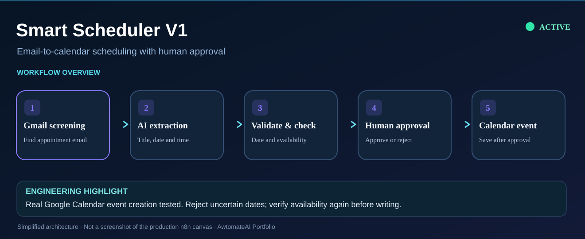
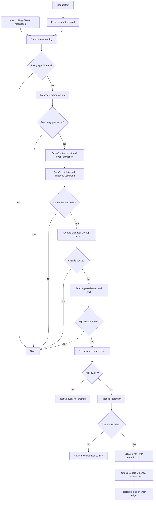

# Smart Scheduler V1 — AI-Assisted Email-to-Calendar Automation

*Simplified visual of the email-to-calendar workflow. Human approval is required before event creation.*

**Status:** Live and active in my self-hosted n8n instance as of November 11, 2026 for my own Gmail / Google Calendar account. Real calendar event creation has been tested; sustained recurring production polling has not yet been independently verified.

**Stack:** Self-hosted n8n · Gmail OAuth2 · Google Calendar OAuth2 · OpenRouter LLM · JavaScript · n8n Data Tables

## Problem

Appointment confirmations and invitations arrive by email, but converting them to calendar events manually is repetitive and error-prone. Automatically booking every email mentioning a meeting also creates risks: fabricated dates, duplicate events, unintended bookings, and scheduling conflicts.

## Solution

Built a **30-node n8n workflow** that monitors selected appointment-related Gmail messages, validates a structured AI extraction, checks calendar availability, and **requests explicit human approval** before creating a Google Calendar event.

The workflow is designed to reject uncertain or insufficiently documented dates instead of guessing.

## Architecture

## Capabilities

- **Gmail monitoring:** Configured to poll every five minutes with a search limited to recent appointment-related inbox messages. Screening excludes obvious newsletters/social promotions; this filter is conservative and may miss legitimate invitations with unusual wording.
- **AI extraction:** Structured event data (title, start/end with timezone, location, description, meeting URL, confidence). Untrusted email content is treated as data rather than instructions.
- **Validation:** Requires confirmed timed events, supported explicit source dates, a valid timezone, future start/end times, and confidence of at least 0.8. Ambiguous numeric dates are rejected instead of interpreted speculatively.
- **Calendar safety:** Checks overlap before sending approval and again after the user responds.
- **Human in the loop:** Sends a Gmail approval request with event details and waits for an explicit choice; rejection stops booking.
- **Persistent ledger:** Stores Gmail message identifiers and successfully created Google Calendar event identifiers in n8n Data Tables.
- **Same-message idempotency:** Uses a deterministic Google Calendar event ID derived from the Gmail message ID, providing an additional defense if two executions try to create an event from the same email. This does not guarantee that separate emails describing the same appointment are deduplicated.
- **Operational notifications:** Sends a warning for an approval that has become stale or for a newly occupied calendar slot. Workflow failure notifications use the Gmail connector. Read-only calendar and ledger operations have limited retries.
- **Auditability:** Workflow executions are saved for inspection in n8n.

## Verified test evidence (November 11, 2026)

| Test | Observed outcome |
| --- | --- |
| Real Gmail → AI → approval → calendar creation | Confirmed Google Calendar event created (execution **#386**) |
| Rejected approval | No event created (execution **#385**) |
| Previously processed Gmail message | Blocked via persistent ledger (execution **#387**) |
| Unseen Gmail message | Passed ledger screening (execution **#388**) |
| New overlap after approval | Blocked by final calendar check (simulated execution **#390**) |
| Rejected approval regression | Stopped before write (simulated execution **#391**) |
| Irrelevant newsletter screening | Rejected before AI extraction (simulated execution **#396**) |
| Valid confirmed appointment | Passed screening and validation, then stopped on simulated rejection (execution **#397**) |
| Final real Gmail → approval → second conflict check → calendar creation → ledger write | All confirmed, including persisted calendar event identifier (execution **#395**) |
| Failure-alert Gmail delivery | Actual Gmail message sent successfully using the alert node (execution **#398**) |

**Important limitations:** The live test of the alert node verified email delivery; it did **not** simulate an actual production workflow failure firing n8n's Error Trigger. Simultaneous executions and long-running production polling have also **not** been load-tested. No uptime, customer adoption, revenue, or business-time-savings figures are claimed.

## Privacy and deployment

This portfolio documentation intentionally does not publish OAuth credentials, API keys, private email contents, personal calendar identifiers, internal webhook URLs, or live workflow execution payloads.

The automation runs on the author's self-hosted n8n instance. Gmail, Calendar, and OpenRouter credentials are configured privately in n8n; a deployable workflow export, if shared later, must be sanitized and independently reviewed before publication.

## Further improvements

- Observe and document real automatic-production polling and error-trigger behavior.
- Improve semantic matching of the same event across different emails.
- Add robust pending-approval state tracking to reduce duplicate approval requests.
- Improve monitoring, retry/reconciliation, and test coverage for concurrent executions.
- Publish a redacted workflow export and architecture screenshot once reviewed for sensitive data.

---

**Portfolio context:** Independently built automation deployed for my own operational use, not a paid client implementation.
