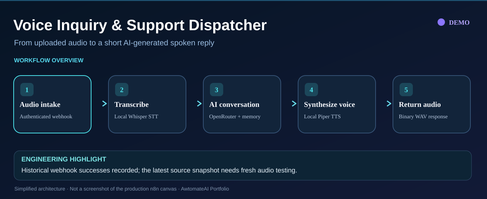

# Automated Voice Inquiry & Support Dispatcher

[← Portfolio](../../README.md) · [Sanitized n8n workflow](workflow.json)

**Status:** The source workflow is active in the development n8n instance. In the November 1–20, 2026 history window, the 50 most recent retrieved execution records contained 35 successes and 15 errors (68 matching records existed in the full window). This exported snapshot is inactive and needs a fresh end-to-end audio acceptance test after configuration.

## Overview

I built this workflow to turn an uploaded voice inquiry into a short spoken response for AwtomateAI. It connects speech recognition, transcript normalization, a conversational AI Agent, session memory and speech synthesis through an authenticated n8n webhook.

The implementation demonstrates orchestration across local speech services and a hosted language model. Despite the project name, this snapshot is an audio request/response pipeline: it does not contain a telephone provider, PSTN calling, a live call-transfer system or a separate intent-based dispatch router.

## Architecture & Tech Stack

| Stage | Connected implementation |
| --- | --- |
| Audio intake | Authenticated POST webhook and JavaScript binary-field normalization |
| Speech recognition | Local Whisper-compatible service at `http://127.0.0.1:5001/transcribe` |
| Transcript preparation | JavaScript whitespace cleanup and spoken-email normalization |
| AI conversation | n8n AI Agent connected to OpenRouter, model selector `openrouter/free` |
| Conversation context | Window Buffer Memory, five interactions, keyed by session/call identifier |
| Speech synthesis | Local Piper-compatible service at `http://127.0.0.1:5002/synthesize` |
| Response | Binary webhook response labeled `audio/wav` |
| Optional action | SMTP email tool; disabled in the portfolio export |

## Key Workflow Logic

1. Accept a POST containing an audio file through a Header Auth-protected webhook.
2. Normalize binary input: use the `audio` property, or copy an incoming `data` property to `audio`. Reject requests without an audio binary.
3. Submit the file as multipart field `file` to the local transcription service, which must return a JSON `text` field.
4. Clean the transcript and normalize recognizable spoken email formats while preserving username punctuation.
5. Send `sanitized_transcript` to the AI Agent. Its prompt requests concise spoken English, describes AwtomateAI services and instructs the agent not to invent business results or tool success.
6. Supply recent context from memory. Reuse a client-provided session/call identifier across turns; without one, the fallback uses the execution identifier and does not establish cross-request conversation continuity.
7. Send the agent's `output` text to Piper's synthesis endpoint, then return the resulting binary audio through Respond to Webhook.

The SVG is a simplified architecture illustration, not a screenshot or evidence of a successful current-version audio test.

## Connected versus unused nodes

The snapshot contains 13 nodes. **OpenRouter Chat Model** is the model connected to the AI Agent. **Ollama Chat Model** (`hermes3:3b`) and **Groq Chat Model** are present but unconnected. An unconnected HTTP node named **Generate Response (Ollama LLM)** actually targets Groq's chat-completions API with `llama-3.3-70b-versatile`. These nodes are retained to reflect the source configuration; they do not form a tested fallback chain. The active conversation path should not be described as fully local Ollama inference.

## Setup & Configuration Notes

1. Import `workflow.json` into a compatible n8n instance. The export is inactive; credentials, live webhook identifiers, instance metadata and execution data are omitted.
2. Select your own Webhook Header Auth credential and OpenRouter credential. The replacement webhook path is `portfolio-voice-inquiry`; obtain the actual test/production URL from your instance.
3. Provide compatible Whisper and Piper HTTP services. Their implementations, voice files and model installers are not included in this project. Verify their audio formats and endpoint response contracts independently.
4. Ensure n8n can reach the speech-service URLs. `127.0.0.1` addresses n8n's own host/network context; it cannot reach a separate Windows computer from a remote n8n server.
5. Keep the SMTP tool disabled for the first audio test. Submit one small audio file, inspect the transcript and AI output, and confirm the returned WAV is playable. Test multiple sessions and repeated turns before publishing an imported copy.
6. Review upstream failures, empty transcriptions, missing binary data, model latency and audio MIME types. The source does not provide a comprehensive dedicated failure-response path or streaming audio implementation.

### Email action boundary

The source agent prompt requires visitor authorization before sending email, but its attached email tool description says to call immediately when an email address is supplied. Those instructions conflict. Prompt wording is not a deterministic permission boundary.

For this reason the **portfolio copy disables the SMTP tool** and replaces the sender with `sender@example.com`; the live source was not modified. Before enabling this tool, reconcile its instructions, configure your own SMTP sender and add an explicit approval mechanism. No email was sent while preparing this portfolio update.

## Validation Evidence & Limits

- Source execution metadata records successful webhook runs including **370, 367 and 366** on November 11, 2026 in Asia/Manila; a nearby run, **365**, failed. This review did not inspect or publish visitor audio/transcripts.
- Those runs predate the latest source edit on November 13. They establish historical execution status, not a fresh acceptance test of this exact export.
- Source node parameter schemas were checked with the n8n MCP validator, including the AI Agent with its connected model represented.
- The export is checked for valid JSON, connection targets, unique node identities, JavaScript syntax and removal of credential references and live webhook paths. The overview SVG is rendered and checked before publication.

No new audio requests, phone calls or email actions were executed for this update. Current audio playback quality, email delivery, live telephony, production uptime and commercial outcomes are not established here. This project is distinct from the separately documented Anna Omnichannel Receptionist text/Supabase workflow.

**Current execution-history note (November 20, 2026):** Active status should not be interpreted as a successful current-version acceptance test. The recent execution history is mixed, and a fresh audio upload → transcription → AI response → WAV playback test is required before describing the workflow as stable.
