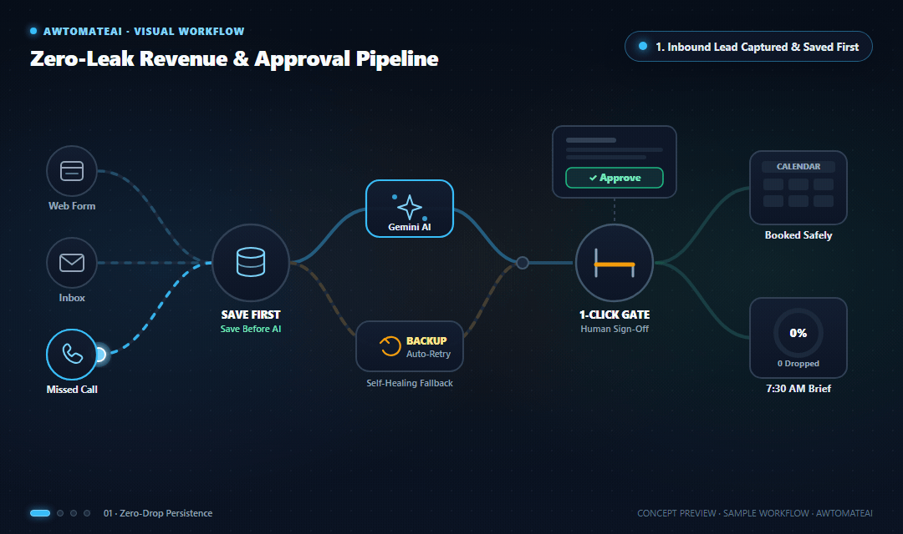
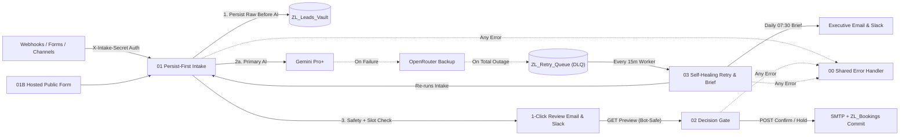

# Zero-Leak Revenue & Executive Guardrail Suite

An enterprise-resilient, human-in-the-loop **n8n automation suite** engineered so **no inbound inquiry is ever dropped, no hallucinated reply is ever sent unapproved, and no AI or webhook outage breaks business operations**.

Designed for founders, clinics, agencies, real estate groups, and service operators who want AI speed **without sacrificing executive control, calendar integrity, or auditability**.

---

## Why Most AI Lead Automations Fail in Production

| Failure Mode | Typical Fragile Automation | Zero-Leak Guardrail Solution |
| --- | --- | --- |
| **LLM Outage / Rate Limit** | Drops inquiry after 500 error; customer receives nothing | **Persist-First Vault** (`ZL_Leads_Vault`) + automatic **Gemini Primary -> OpenRouter Fallback** + **DLQ Self-Healing Retry Worker** (`Every 15m`) |
| **Link Scanner Auto-Approvals** | Slack unfurler (`Slackbot-LinkExpanding`) or corporate SafeLinks prefetches `GET ?action=approve` and accidentally emails clients | **Bot-Safe Two-Phase Gate**: `GET /decision` renders read-only confirmation + blocks preview bots; only explicit `POST /commit` dispatches outbound mail |
| **Duplicate / Replay Clicks** | Double-clicking email approval sends 2 client replies & 2 bookings | Strict **State Machine + Approval Token** (`QUEUED_FOR_APPROVAL -> DISPATCHED`) blocks replays with `409 Conflict` |
| **Calendar Double-Booking** | Race condition books two clients in the same time slot | **Pre-Dispatch Slot Verification** against `ZL_Bookings` immediately before email send halts collisions (`409 SLOT_CONFLICT`) |
| **Urgent / Legal Escalations** | Emergency inquiries sit unnoticed in generic folders | Deterministic **Keyword Safety Override** (`legal`, `data breach`, `lawsuit`, `attorney`, `emergency`, etc.) forces `CRITICAL` priority |
| **Opaque Errors** | Silent background failures | Shared **Error & Audit Handler** (`00`) + daily **7:30 AM Executive Morning Brief** via SMTP & Slack |

---

## System Architecture

---

## Included Workflows (`./workflows/`)

| File | Workflow Role | Key Engineering Controls |
| --- | --- | --- |
| [`00-shared-error-handler.json`](./workflows/00-shared-error-handler.json) | **Shared Error & Alert Handler** (`3` channels: Data Table + SMTP + Slack) | Catches unexpected execution failures from all suite workflows via `errorWorkflow` |
| [`01-persist-intake-ai-fallback.json`](./workflows/01-persist-intake-ai-fallback.json) | **Persist-First Intake, AI Fallback & Approval Queue** (`34` nodes) | Header secret gate, `400` validation, duplicate lead idempotency, raw persistence BEFORE AI, Gemini primary + OpenRouter backup + DLQ capture, deterministic safety keyword override |
| [`01b-public-demo-intake-form.json`](./workflows/01b-public-demo-intake-form.json) | **Public Demo Intake Form Adapter** (`3` nodes) | Hosted public intake form separated cleanly from `RespondToWebhook` nodes to avoid `FormTriggerV2` runtime conflicts |
| [`02-bot-safe-approval-gate.json`](./workflows/02-bot-safe-approval-gate.json) | **Bot-Safe Approval Gate & Safe Dispatch** (`39` nodes) | Bot prefetch shield + read-only `GET` confirmation page + explicit `POST` commit, token verification (`403`), replay lock (`409`), live pre-dispatch slot conflict guard, SMTP error boundary |
| [`03-dlq-retry-executive-brief.json`](./workflows/03-dlq-retry-executive-brief.json) | **DLQ Self-Healing Worker & 7:30 AM Executive Brief** (`35` nodes) | 15-minute `SplitInBatches` DLQ retry worker that re-runs Workflow 01 and verifies Vault recovery; daily `07:30 Asia/Manila` KPI digest with 3-tier narrative fallback (Gemini -> OpenRouter -> Deterministic) |

---

## Real Engineering Lessons Solved During Live E2E Testing

1. **Defeating Link-Scanner Prefetching (`Slackbot-LinkExpanding`)**: During initial live tests, Slack's crawler prefetched `GET` approval URLs inside Slack cards within 700ms and triggered auto-approvals. Splitting the approval gate into a **bot-safe, read-only `GET /webhook/zero-leak/decision` confirmation page** plus an **explicit `POST /webhook/zero-leak/commit` form/JSON endpoint** eliminated accidental dispatches from chat bots, Gmail image proxies, and enterprise SafeLinks scanners.
2. **Gemini Thinking-Token Output Budgets**: Reasoning tokens on `models/gemini-3-flash-preview` share `maxOutputTokens`. Raising `maxOutputTokens` to `2048` and stripping Markdown JSON fences in a dedicated JS parser node resolved mid-sentence narrative truncation and structured-parser mismatches.
3. **Sub-Workflow Terminal Output Indexing**: In n8n, if a sub-workflow's final node is a branching `IF` taking `main[1]` (False) with nothing downstream, `Execute Sub-workflow` forwards `[[], [item]]` and halts parent `main[0]` execution. Wiring a dedicated terminal `Set` node (`Subworkflow Intake Complete`) onto `main[0]` restored reliable `SplitInBatches` DLQ recovery loops.
4. **`FormTriggerV2` vs `RespondToWebhook` Coexistence**: n8n blocks `FormTriggerV2` execution whenever `RespondToWebhook` nodes exist in the same workflow graph. Moving the public form trigger into lightweight adapter workflow [`01b-public-demo-intake-form.json`](./workflows/01b-public-demo-intake-form.json) keeps both hosted UI forms and authenticated JSON webhooks operational.

---

## Setup & Deployment

1. **Create 4 n8n Data Tables** matching [`docs/ARCHITECTURE_AND_TABLES.md`](./docs/ARCHITECTURE_AND_TABLES.md):
   - `ZL_Leads_Vault`
   - `ZL_Retry_Queue`
   - `ZL_Bookings`
   - `ZL_Audit_Log`
2. **Import the 5 workflows** from `./workflows/` (`00` -> `01` -> `01B` -> `02` -> `03`).
3. **Bind your credentials** in n8n (no hardcoded keys exist in exports):
   - Google Gemini API (`googlePalmApi`)
   - OpenRouter API (`openRouterApi`)
   - SMTP (`smtp`)
   - Slack Bot (`slackApi`)
   - Header Auth (`httpHeaderAuth` with header name `X-Intake-Secret` or your chosen secret header)
4. **Update Table/Workflow ID placeholders** (`<ZL_LEADS_VAULT_TABLE_ID>`, `<WF_00_ERROR_HANDLER_ID>`, `<WF_01_INTAKE_ID>`, `<YOUR_SLACK_CHANNEL_ID>`, and your n8n domain).
5. **Run verification checks**:
   - Inspect [`tests/E2E_VERIFICATION_REPORT.md`](./tests/E2E_VERIFICATION_REPORT.md) for all tested execution scenarios.
   - Run `python tests/verify_endpoints.py --base-url https://your-n8n-instance.example.com`.

---

## Stage & Boundaries

- **Environment:** Active across 5 published workflows (`118` total nodes, all active versions matching current drafts) on a self-hosted developer n8n instance.
- **Test Data:** Verified on November 24, 2026 using synthetic prospect inquiries delivered to developer-controlled SMTP/Slack sinks (`10` vault leads, `0` dropped, `2/2` DLQ recoveries, `6` confirmed bookings, `4` security/conflict blocks). This is not a paid-client production deployment, and no revenue or conversion lift is claimed.
- **Error Handler:** Shared error handler `00` is wired as `errorWorkflow` on workflows `01`, `01B`, `02`, and `03`, and was verified via manual execution (`#1686`) delivering audit persistence, SMTP, and Slack notifications.
- **Public Exports:** All workflow JSON files under `./workflows/` are sanitized inspection/import templates with instance IDs, webhook IDs, credentials, channels, and private URLs replaced by placeholders.
